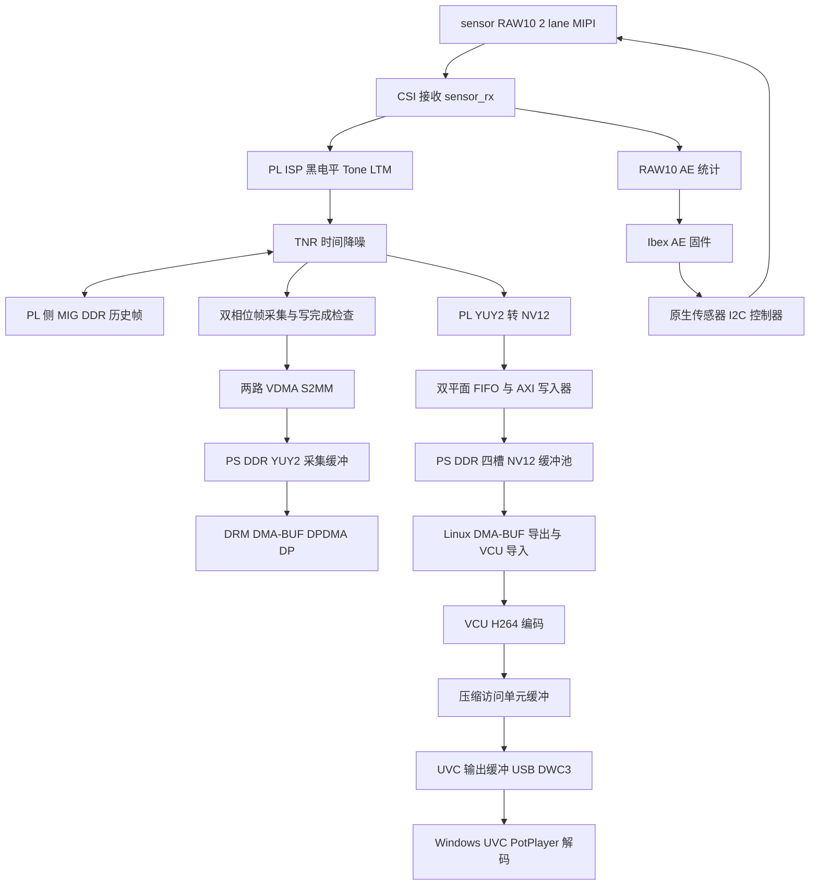
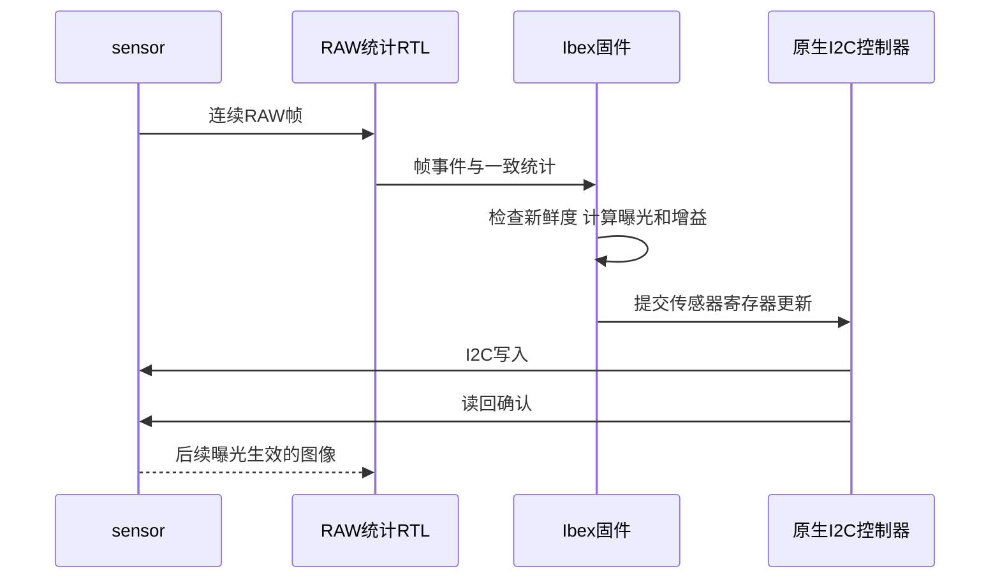

# MiniZU ZU4EV 摄像头系统工程详解

版本日期：2026 年 11 月 5 日。对象：sensor 1280×1024 120 fps 摄像头、Ibex ISP 主控、单核 A53 Linux、VCU H.264、DP 与 UVC USB 输出工程。

本文以当前仓库源码和 2026 年 11 月 5 日 NV12 RAM 上板测试为依据解释系统。当前已验证版本由 PL 在最终 ISP/TNR 输出后生成 NV12，并通过 DMA-BUF 交给 VCU，替代 A53 逐像素转换。该版本仅完成临时 RAM 启动，未更新 QSPI；复位或重新上电会回到原存储启动映像。历史记录中的“未集成”“待验证”需结合日期理解，编译宏、启动参数与活动寄存器共同决定实际行为。本文用 sensor 统称图像传感器；接口、分辨率和帧率描述对应本次已验证配置，更换型号后需重新核对。代码中的历史文件名、设备节点和宏保留实际名称。详细测试见 [NV12 上板记录](../../platform/zu4ev/isp/nv12/BOARD_TEST.md)。

## 1 先建立整体认识

这是一个异构视频系统：FPGA 可编程逻辑 PL 负责实时像素流水线；PL 内的 Ibex 负责自动曝光控制；芯片 PS 内的一颗 A53 运行 Linux，管理采集帧、显示、编码和 USB；VCU 硬件执行 H.264 压缩。

可以把系统分成三个平面：数据平面搬运像素和码流，控制平面配置寄存器和传感器，观测平面记录帧序号、错误、时间戳和运行状态。理解工程时，先追踪一帧图像，再追踪一次曝光调整，最后理解启动和错误恢复。

| 执行主体 | 主要职责 | 主要输入和输出 |
|---|---|---|
| sensor | 曝光并输出 RAW10 | I2C 设置；2 lane MIPI CSI 视频 |
| PL 接收与 ISP | 解包、亮度处理、统计、时间降噪 | RAW10 → YUY2 |
| PL 采集与 VDMA | 保留 YUY2 显示/快照采集 | YUY2 → PS DDR |
| PL NV12 输出外设 | 格式转换、双平面打包、写完成和缓冲管理 | 最终 YUY2 → PS DDR NV12 |
| PL Ibex | 读 RAW 统计，计算曝光和增益，控制传感器 | 统计、FE/SOF → I2C 与 ISP 配置 |
| A53 Linux | 管理 DMA-BUF、显示、VCU 与 USB 队列 | NV12 缓冲描述符 → VCU；码流 → UVC |
| VCU | H.264 硬件压缩 | NV12 → H.264 访问单元 |
| PS DPDMA 与 DP | 从内存读取并显示采集画面 | YUY2 帧 → 显示器 |
| PS USB DWC3 | 发送 UVC 视频 | H.264 数据 → Windows 摄像头设备 |

### 整体数据路径



图中的 PS DDR 和 TNR 历史存储不是同一个软件缓冲池。TNR 的存储由 PL 侧 memory bridge、跨时钟桥和 MIG 路径管理；YUY2 采集帧由 VDMA 写到 PS DDR，NV12 帧由独立 AXI 写入器写入另一个 PS DDR 缓冲池。两条输出在最终 TNR 后分叉，共享像素来源，不共享帧缓冲。

## 2 从传感器到屏幕逐步追踪一帧

### 2.1 传感器输出与 CSI 接收

sensor 在曝光完成后输出 RAW10 数据。2 lane 指 MIPI 物理数据通道数；进入 PL 的并行接口每个有效拍包含两个 10 bit 像素，低 20 bit 分别承载两点，不能把它理解成已经排好的 RGB。

`rtl/sensor/sensor_rx.v` 封装 CSI 控制、接收 IP 和 PHY 故障同步。SOF 标记帧开始，EOL 标记行结束，FE 是帧结束事件。像素数据、valid、SOF、EOL、packet error 和 global fault 必须保持对应关系。发生错误时，仅有正确像素数量仍不足以证明一帧可信。

传感器是持续输出源，不能像普通软件队列一样随时暂停。下游 FIFO 用来吸收短暂停顿；长期处理不及时会造成溢出或丢帧。设计中的 READY 信号不意味着能够把背压一路传回传感器。

### 2.2 ISP 与统计分支

生产顶层明确选择 `isp` 的 `PIPELINE=1、USE_LTM=1、USE_TNR=1、ISP_RUNTIME=1`。这些参数表示对应硬件已经综合进设计；运行时是否启用某项处理，还由活动配置决定。

`isp_capture_frontend.sv` 从原始输入分出 `ae_stats_raw10` 统计路径，同时送入图像处理路径。AE 统计因此不是从 H.264 解码画面或 DP 截图反推，而是在 RAW10 域累加、计数并产生均值、帧号和统计序号。ROI、黑电平和使能状态也随统计结果记录。

全局 Tone 路径对每个像素进行黑电平校正与查表映射。历史标定使用 RAW10 黑电平 52，但它与曝光、增益、温度有关。固定 ROM 分支把减黑电平和非线性映射折叠成查表；运行时 LTM 路径则有自己的配置和曲线存储，不能把所有分支都理解为同一个固定 ROM。

LTM 先用 5×5 双边滤波分离基础层 B 和细节层 D，其中 I=B+D；基础层经过 Tone 曲线，再与缩放后的细节重建。双边滤波同时考虑空间距离与灰度差，因此比普通均值滤波更能保留边缘。`gain/256` 是细节系数，例如 96 对应 0.375。行缓存形成窗口，边界采用复制，帧末必须排空缓存才能输出最后几行。

处理后的亮度以 YUY2 打包：两个像素对应四个字节 `Y0 U Y1 V`。本工程灰度通路使用 U=V=128。YUY2 是承载格式，采用 YUV 格式并不表示 ISP 已生成彩色图像。

### 2.3 TNR 时间降噪

`isp.v` 中的 `isp_tnr_node` 位于前端之后。它根据当前帧和历史帧的差异选择融合强度，静止区域更适合融合，运动区域需要减弱融合以避免拖影。alpha 和 motion-low/high 是运行时控制量。

历史帧需要帧级存储，通过 `tnr_memory_bridge.sv` 和 `platform` 内的 MIG 路径读写。复位默认旁路；内存校准成功并不等于 TNR 已启用。清历史后，第一帧先建立历史。改变上游 Tone、LTM 模式或曲线后，应清历史，避免把不同映射下的亮度混合。

TNR 能压低帧间变化的随机噪声，但固定在同一像素上的偏差可能留在历史中。暗部曲线和曝光增益也会放大噪声，所以“打开 ISP 后更亮且噪点更多”必须在相同曝光条件下逐项比较。

### 2.4 双路采集和 VDMA

`video_capture.v` 为两个通道共用一组 source sequence 和 source tick，通道 0 选择偶数源帧，通道 1 选择奇数源帧。这里的“双核采集”是两套采集硬件，不是两个 A53 CPU 核，也不是两台摄像机。

每个通道都有帧选择、arm/ack/epoch 握手、FIFO、尺寸和错误检查，以及 VDMA 写完成保护。交替处理使一路在本帧完成与重新准备时，另一路有机会接收下一帧。

`vdma_write_guard_v2.v` 在面向 DDR 的 AXI 写接口观察地址、数据和写响应。它核对实际写入字节数以及事务退休状态。像素流已经到帧尾，并不意味着 DDR 写响应已经返回；在这个时间点过早交给显示器或 USB，就可能读到未写完的帧。

Linux 的 `sc130_capture` 驱动把两路硬件组织成逻辑采集设备，处理顺序、代际、停止状态和 V4L2 缓冲完成。用户态用 DQBUF 取得完成帧，用 QBUF 归还可再用缓冲。

### 2.5 DP 显示

桥接程序通过 DMA-BUF 导出或共享采集缓冲，DP 使用 DRM/PRIME 导入，DPDMA 从 PS DDR 读取。应用提交新画面后，必须等待显示系统确认旧帧退役，才可释放旧帧的占用。

DP 使用原始 YUY2 采集帧，因此不经过 H.264 压缩与解码。显示输出频率、扫描时序和摄像头帧率是不同概念；不能仅凭“采集 120 fps”就推导显示器的实际刷新模式。

### 2.6 PL NV12 输出与 VCU 编码

NV12 版本以 `SC130_NV12` 编译宏启用。`camera_top.v` 中 `nv12_capture_peripheral` 直接接入最终 ISP/TNR 输出 `converted/cv/cs/ce`，错误输入为 `packet_d | fault_d`，因此编码画面包含最终处理结果。显示分支仍走原 YUY2 采集与 VDMA。顶层采用独立外设，不应再同时启用 `isp.v` 内的可选 NV12 转换器，避免重复实例。

`isp_yuy2_nv12.v` 每拍处理 `Y0 U Y1 V` 两个像素，将 Y 分离，相邻两行的 U/V 按 `(上一行+当前行+1)>>1` 舍入平均，输出 4:2:0 交织 UV。转换器保存一行色度，不需要整帧像素缓存；持续输入无法暂停，溢出或异常帧必须丢弃并在后续 SOF 恢复。

Y、UV 各自经过打包 FIFO，形成 128 bit AXI 写数据。`nv12_ddr_writer.v` 将两个平面写入同一槽位：Y 位于 `base`，UV 位于 `base + stride × height`。当前 1280×1024、stride=1280，Y 为 1310720 字节，UV 为 655360 字节，合计 1966080 字节。突发最多 16 拍，不跨行或 4 KiB 边界；完整帧只有在全部 AXI B 写响应退休后才能发布。发生写错误时先排空已接受的事务，再报告失败。

`nv12_buffer_pool.v` 管理四个独占槽位及完成 FIFO，避免槽位循环复用造成时间顺序颠倒。没有空闲槽时丢弃新源帧，不能覆盖 VCU 正在读取的槽位。Linux `sc130_nv12` 驱动分配四块持久 coherent DMA 内存，总计 7.5 MiB，通过 `/dev/sc130-nv12` 导出 DMA-BUF；VCU 以 `V4L2_MEMORY_DMABUF` 导入相同内存。应用不再映射、复制或转换原始编码输入像素，但仍管理队列和压缩码流。

一帧的交接顺序是：硬件写响应全部完成 → IRQ/驱动 TAKE → 应用 `SC130_NV12_DQBUF` → VCU 输入 QBUF → VCU 输入 DQBUF → `SC130_NV12_QBUF` 归还槽位。压缩 AU 已产生，不等于 VCU 输入槽已经释放。V4L2 编码器的 OUTPUT 队列接收原始输入，CAPTURE 队列返回压缩输出。

桥接程序使用 `--nv12 /dev/sc130-nv12` 选择新路径。未指定该选项时，旧 `encoder_convert()` NEON 路径仍可供匹配平台使用，但本次 NV12 启动配置不会自动回退到 CPU 转换。编码仍为 H.264，支持 60/120 fps，默认目标码率 20 Mbps、Baseline/Level 5.1；本次改动没有切换到 H.265。120 fps 模式提交每张交付帧，60 fps 模式可在交给 VCU 之前按完成时间筛选帧；时间戳是完成/IRQ 时间，并非源 SOF 时间。

### 2.7 UVC 与电脑播放

`platform_bridge.c` 将编码 AU 复制到 UVC 输出缓冲，使用真实的 `bytesused` 提交。USB gadget 以 frame-based H.264 描述符枚举，Windows 将其识别为摄像头；PotPlayer 通过采集接口接收并解码。不能用 YUY2 描述符传送 H.264 内容。

发送层的 8192 字节载荷设置是 USB 请求覆盖与调度参数，不是 H.264 帧尺寸，也不是固定每帧 8192 字节。一个 AU 可以由多个 USB 载荷传输。帧序、时间戳与 UVC 边界必须一起保持正确。

新会话需要 SPS/PPS/IDR。SPS/PPS 描述解码参数，IDR 提供独立恢复起点；普通预测帧可能引用前面图像。当前恢复逻辑在计数到 USB ERROR 后丢弃后续预测 AU，等待验证通过的 SPS/PPS/IDR 再恢复发送。错误仍然计数，这种机制修复播放连续性，不代表已找出 DWC3 偶发错误根因。

## 3 DP 与 USB 到底共享什么

| 存储对象 | 写入者 | 读取者 | 何时可再用 |
|---|---|---|---|
| YUY2 采集帧 | VDMA | DP、可选快照；旧模式可由 A53 转换器读取 | 所有当前使用者释放后 |
| NV12 输入帧 | PL NV12 AXI 写入器 | VCU，经 DMA-BUF 导入 | VCU 输入 DQBUF 后，由驱动归还槽位 |
| H.264 AU | VCU 与编码驱动 | 桥接程序 | 读取复制完成并归还编码器后 |
| UVC 输出缓冲 | A53 | USB gadget/DWC3 | 输出 DQBUF 完成后 |
| TNR 历史 | TNR 存储逻辑 | TNR | 由硬件历史帧调度决定 |

DP 和 USB 编码的共同起点是最终 ISP/TNR 像素流。NV12 版本在写 DDR 之前分成两路：DP 使用 YUY2 采集池，编码使用四槽 NV12 池，二者没有共享同一张内存帧，也不保证丢帧后逐帧一一对应。压缩不会覆盖 DP 源帧。旧 CPU 转换模式才从 YUY2 采集帧读取像素；原始 YUY2 USB 恢复模式还可直接共享采集 DMA-BUF。

缓冲管理的关键是所有权。DP 还扫描旧 YUY2 帧时，采集不能覆盖它；VCU 还持有 NV12 输入时，PL 不能重写该槽。NV12 原始输入通过 DMA-BUF 共享，压缩 AU 到 UVC 输出缓冲仍有用户态复制，因此不能将整个输出链称为端到端零拷贝。

停止编码时先 STOP PL 并等待 IDLE，再 STREAMOFF/关闭 VCU，最后关闭 capture 与导出 fd。STOP 的 AXI-Lite 写响应只表示接受命令，IDLE 才表示已排空 PL 写事务；IDLE 不表示 VCU 已释放缓冲。驱动停止超时会保留内存并使会话失效，不能为了恢复而释放仍可能被 DMA 访问的内存。重启只从后续 SOF 接收新帧，不能用全局复位代替运行中的 STOP。

没有可用编码输入缓冲时，可丢弃尚未编码的源帧；已经编码的预测链应按顺序发送。USB 停止或断开关闭相应编码会话，YUY2 采集与 DP 独立继续。

## 4 Ibex 子系统逐层理解

Ibex 是综合在 PL 中的 RV32IMC 处理器，与 ARM A53 是两套 CPU。当前原生固件的任务是 ISP/AE 控制，像素处理由周围的专用 RTL 完成。固件来自独立交叉编译，随后转换为 FPGA 可加载的存储初始化内容。

| 模块 | 职责 |
|---|---|
| `ibex_small_core.sv` | 包装 small 配置 Ibex 内核，保留 RegFileFF |
| `ibex_small_system.sv` | 组织内核、存储、地址译码、中断和可选外设 |
| `ibex_small_mem.sv` | 程序区、数据 RAM、双口观测与引导复制 |
| `ibex_native_to_axi_lite.sv` | 将原生 MMIO 请求转成 AXI-Lite 事务 |
| `ibex_isp_cfg_cdc.sv` | 跨控制时钟域传递 ISP 配置事务 |
| `ibex_isp_snapshot.sv` | 获取跨视频域的一致统计和帧事件 |
| `ibex_isp_cfg_owner.sv` | 仲裁 PS/Ibex 对 ISP 与传感器的控制所有权 |
| `ibex_sensor_ctrl.sv` | 传感器控制状态、授权、停止及超时管理 |
| `ibex_sensor_i2c.sv` | 实际 I2C 时序、寄存器读写和开漏驱动 |

### 4.1 程序与数据存储

程序地址为 `0x00100000..0x0013ffff`，数据 RAM 为 `0x00200000..0x0023ffff`，各 256 KiB，复位入口位于程序基址加 0x80。板级选择 UltraRAM 以节省 BRAM；UltraRAM 本身不能像初始化 ROM 那样随配置直接提供全部程序内容，因此小型 BRAM 引导内容在释放 CPU 前复制到程序 UltraRAM，并补零。

完整程序空间的复制需要 131072 个时钟，在 100 MHz 下约 1.31 ms。这只是存储准备时间，不是整机启动时间。全局复位会重做复制；仅 CPU 复位保留已经加载的程序内容。

`0x0023e000` 是原生 AE mailbox。它记录 state、heartbeat、fault、FE/SOF、统计帧号、均值、曝光、增益、修改次数和异常现场。512 条记录环提供历史，不能只看一个初始化成功签名就认定 AE 已收敛。

### 4.2 统计跨域和中断

图像统计发生在视频时钟域，Ibex 主要工作在 100 MHz lite 域。一个多位统计总线若逐 bit 用双触发器同步，可能拼出来自不同帧的混合值。snapshot 握手使读者取得一致的一组数据；FE/SOF 序号用于确认统计对应的时间和更新边界。

帧事件进入 Ibex 中断路径，固件再读统计、检查序号和状态。中断不是“传递整幅图像”，只是在告诉控制程序某个事件发生了。

### 4.3 自动曝光闭环



固件启动先验证历史板级 ID 0130、stream-on、VTS、曝光和增益，并启用或读回 AE 控制。策略保留 target96、deadband8、有限步长曝光/增益调整及四个 FE 的 holdoff，避免每帧追着噪声震荡。target96 的含义应结合 AE 算法内部归一化理解，不能直接当成播放器中的 8 bit Y=96。

I2C 更新前后检查 FE/SOF、超时与读回，出错进入 fail-stop 并记录 fault。软件观察到的 FE 晚于真实线上的 FE，因此不能据此证明传感器的物理锁存边界，也不能证明两字节曝光更新具有物理原子性。

## 5 A53 与 Ibex 如何安全交接

上电时 PS/FSBL 负责传感器和基础平台初始化。之后 Linux 的 `ibex_isp_handoff` 把控制权交给 Ibex。R5 AE 和其他 PS I2C/ISP 写入者必须停止，防止两套控制器同时改同一设备。

交接工具检查 IIC0 时钟与复位状态、控制器空闲、FIFO 状态、ISP 标识与待提交状态、固件 boot-ready 和新鲜的 quiescent 应答。物理 I2C 切换还要求 PS 已释放 SCL/SDA，且两线连续高电平至少 5 μs。I2C 使用开漏方式：控制器只能拉低或释放，不能推挽强驱高。

```sh
ibex_isp_handoff status
ibex_isp_handoff start --ps-writers-stopped
# 停止并收回控制权
ibex_isp_handoff stop
```

`--ps-writers-stopped` 记录调用者已停止其他写入者，工具无法识别所有可能运行的独立程序。停止时 RUN=0，请求带 stop toggle/ack；固件完成当前字节组及读回后确认静止，随后才能回收控制权。超时退出而不强抢总线。

CPU-only reset 不立即截断已经接受的 I2C 事务；硬件使其完成 STOP 或达到超时，再释放线，并置 restart-required。需要停止回收后开启新会话，旧 RUN=1 不能自动重新启动 AE。

## 6 地址和总线地图

同一个 ISP 的寄存器，在 A53 和 Ibex 看来有不同地址。CPU 的地址只在各自总线映射下有意义，不能拿 A53 物理地址直接写进 Ibex 程序。

| 地址视角 | 基址 | 对象 |
|---|---|---|
| A53 PS | `0xA0000000` | VDMA 0 |
| A53 PS | `0xA0010000` | Capture 0 |
| A53 PS | `0xA0020000` | VDMA 1 |
| A53 PS | `0xA0030000` | Capture 1 |
| A53 PS | `0xA0040000` | ISP |
| A53 PS | `0xA0050000` | TNR |
| A53 PS | `0xA0060000` | RAW 调试 VDMA 配置区域 |
| A53 PS | `0xA0070000` | RAW 调试 capture 区域 |
| A53 PS | `0xA0080000` | NV12 输出外设，64 KiB，ABI v2 |
| A53 PS | `0xA1000000` | VCU 控制区域基址 |
| Ibex | `0x50000000` | ISP 统计与事件 snapshot |
| Ibex | `0x51000000` | ISP 配置访问窗口 |
| Ibex | `0x52000000` | 原生传感器控制 |
| Ibex | `0x0023e000` | AE mailbox |

ISP 的 PS 窗口 +`0xff00/0xff04/0xff08` 保留所有权、停止和故障相关观测，即使 Ibex 占有 ISP 仍可读取相应状态。RAW 调试通路存在源码和硬件映射，不表示生产主链必须启用它。

NV12 控制接 `control_xbar/M09_AXI`，128 bit 写主接口接 `memory_xbar/S06_AXI` 再到 PS HP0 DDR。中断接 `pl_ps_irq1[0]`，GIC INTID=136，设备树使用 SPI 104（`<0 104 4>`）。寄存器 ID 为 `0x4e563132`、版本 2；CONTROL +0x08 的 bit0 为 IRQ 使能、bit1 为采集 ENABLE，STATUS +0x0c 的 bit2 为 IDLE，COMMAND +0x20 写 8 请求 STOP。+0x30/+0x34 分别记录无缓冲丢帧和失败帧，STOP 主动中止当前帧也可能增加失败计数，不能直接将它等同于 AXI 错误数。完整定义见 `platform/zu4ev/isp/nv12/REGISTERS.md`。

AXI4-Stream 承载像素：数据与 valid/ready、SOF/EOL 相伴。AXI4-Lite 承载寄存器控制：地址与数据通道独立握手。AXI memory mapped 全接口承载帧存储突发读写。中断通知“有事发生”，共享存储承载结果。I2C 则连接真正的传感器管脚。

## 7 RTL 顶层模块地图

`platform/zu4ev/rtl/camera_top.v` 是生产综合入口，旧 `sc130_camera_top_v2.v` 是转发兼容封装。

| 顶层子模块 | 功能 | 阅读时关注 |
|---|---|---|
| `platform` | 参考时钟、复位、TNR 存储和 MIG/CDC | 时钟锁定、校准、各域 reset |
| `soc_subsystem` | PS block design 与 I2C 引脚路由 | PS AXI、VDMA、VCU、开漏线 |
| `sensor_rx` | CSI 控制与接收 | RAW packing、帧标记、PHY fault |
| `isp` | 前端 Tone/LTM、RAW AE 统计与 TNR | 编译参数、活动配置、标记延迟 |
| `video_capture` | 两个帧相位、guard、寄存器和中断 | source_seq、epoch、写响应 |
| `nv12_output`（`nv12_capture_peripheral`） | 最终 ISP 输出到 NV12 DDR、四槽管理和 AXI-Lite/IRQ | B 响应退休、完成 FIFO、STOP/IDLE 与 VCU 持有 |
| `debug_monitor` | GPIO snapshot、同步器、诊断和 ILA | 原子快照、计数器含义 |
| `ibex_debug_i` | 板级 Ibex 系统接入 | 统计、MMIO、传感器授权和复位 |
| `ibex_isp_owner_i` | PS/Ibex 控制交接 | owner、run、stop、grant |

`hardware/ps_system.tcl` 重建 PS block design 和地址映射，并加载 `add_vcu.tcl`。NV12 隔离工程由 `tools/build_nv12_project.tcl` 基于已验证工程建立，再加载 `hardware/add_nv12.tcl` 扩展接口。`SC130_NV12` 必须与新增 BD 端口匹配，且保留原 FPGA/Ibex ROM 编译定义。Xilinx IP 在 Vivado 中生成，不应把生成目录当作手写源码的主要阅读入口。

## 8 Linux 软件与驱动模块地图

| 文件或组件 | 职责 |
|---|---|
| `software/platform_bridge.c` | 主事件循环，连接采集、DP、编码、USB 和退出恢复 |
| `software/capture_broker.h` | 采集缓冲的持有和释放规则接口 |
| `software/dual_core.h` | 双采集通道顺序与状态契约 |
| `software/dp_display.c` | DRM 显示、导入帧、翻页和退役 |
| `software/h264_encoder.c` | Allegro 枚举、NV12 DMA-BUF 导入及归还、编码 AU；保留旧 NEON 模式 |
| `software/nv12_capture.h` | NV12 GETBUF/START/STOP/DQBUF/QBUF 用户态 ABI |
| `software/nv12_vcu_probe.c` | VCU 输入布局查询与真实 NV12 编码探测 |
| `linux/kernel/sc130_nv12.c` | 四槽 coherent 内存、DMA-BUF 导出、完成 IRQ 和所有权 |
| `linux/dt/sc130-nv12.dts` | NV12 寄存器与 SPI 104 中断描述 |
| `linux/build_nv12_runtime.sh` | 模块、设备树、静态 AArch64 应用和运行时 overlay 构建 |
| `software/uvc_core.c` | UVC 协议相关公共处理 |
| `software/perf_stats.h` | 进程 CPU 与分段延迟统计 |
| `software/ibex_isp_handoff.c` | Linux 与 Ibex 控制权协调 |
| `software/isp-control/ispctl.c` | ISP 寄存器、模式、曲线和统计控制 |
| `software/tnr-control/tnrctl.c` | TNR 配置、历史清除和内存测试 |
| `linux/start-platform.sh` | 单核限制、模块加载、gadget 与应用启动 |
| `linux/setup_uvc.sh` | 创建 USB gadget 与 H.264/YUY2 描述符 |
| `linux/kernel/sc130_capture.c` | 双相位采集到 V4L2 接口，实际路径以文件索引为准 |
| Linux Allegro/VCU 驱动与固件 | VCU 时钟、资源发现、通道和硬件编码 |
| Linux DRM/DPDMA 与 UVC gadget | 显示、USB 内核队列和完成通知 |

部分 broker/dual-core 实现可能位于头文件内，不能仅凭没有同名 .c 判断功能缺失。R5 AE、早期 shadow 模式和 OpenTitan 可选外设源码保留作参考，生产 AE 使用原生 Ibex 控制器。

## 9 时钟 复位与配置提交

100 MHz lite 域主要服务控制；视频域服务像素；TNR 内存有 MIG 用户时钟域；VCU 最终记录使用 100 MHz AXI-Lite、200 MHz 编码和内存接口、33.333333 MHz 参考。新增 NV12 外设、HPM0/control 相关端口、memory interconnect 与 HP0 端点实际均使用 200 MHz video 时钟；新增路径不另加 AXI CDC。已有 VCU 100 MHz 控制时钟保持不变。不同域的精确网络应以当前硬件 Tcl 与时钟报告为准，不能将所有控制口都假设成同一个时钟。

跨域需要事务桥、异步 FIFO 或一致快照。单 bit 状态同步、计数器 Gray 编码和多 bit 数据握手各自有适用范围。复位必须与目标域协调，不能只复位发起端却让对端把旧事务当成新请求。

ISP/TNR 使用 shadow 与 active 配置分离：CPU 写 shadow，apply 发起提交，硬件在安全帧边界切换，并更新 applied sequence。命令返回超时可能留下待提交请求，应先查看状态。中途改曲线会让同一帧上下部分使用不同映射，因此配置提交本身也是视频正确性的一部分。

## 10 启动和 QSPI 文件的关系

```text
QSPI 启动映像
  → BootROM
  → FSBL 初始化 PS DDR 时钟与摄像头 并按启动项配置 PL
  → PMUFW 与 BL31 等平台固件配合
  → U-Boot
  → FIT 中 Linux Image DTB initramfs
  → /init 与 start-platform.sh
  → capture 驱动 DP USB VCU 与桥接应用
  → ISP TNR 启动配置和 Ibex 安全交接
```

FSBL、bitstream、设备树、内核、模块、VCU 固件和应用必须匹配。bitstream 决定有哪些硬件，DTB 告诉 Linux 它们的地址和中断，驱动提供设备接口，应用组织完整业务。只更新 bitstream 不会自动更新 Linux 应用。

生产打包采用 BOOT 起始偏移 0，FIT 偏移 `0x00c00000`，NOR 容量 32 MiB。RAM-test 启动包用于临时 DDR 验证，与生产 QSPI 包有明确区别，不能相互替代。生成文件、RAM 启动成功、烧写读回成功、冷启动通过是四种不同证据。

本次 NV12 验证使用 `build/nv12_platform/ram_candidate/BOOT.BIN` 与 `image.ub`，通过已验证的 FSBL 断点/JTAG 装载 DDR 启动。保留原内核与 VCU 固件，加入新 DTB、`sc130_nv12.ko` 和桥接应用；`/etc/sc130-nv12.conf` 在原 `/etc/sc130-platform.conf` 后加载，设置 `SC130_USE_NV12=1` 和 `UVC_FORMAT=h264`，启动脚本加载模块并传入 `--nv12`。不应将新 DT/驱动与缺少 `0xA0080000` 外设的旧 bitstream 配对。

本次没有擦写 QSPI，也没有新增 NV12 QSPI 冷启动验收。仓库板级记录包含某阶段“尚未烧 QSPI”的历史文字；本聊天之后又执行过烧录请求并提供了 PotPlayer H.264 截图。本文不据旧记录否定后续操作，也不在没有读取后续烧录日志时新增冷启动成功结论。识别当前部署版本应对照最新烧录与 readback 记录及 SHA256。

## 11 NV12 硬件版本释放了多少 A53 算力

旧版本使用 A53 NEON 转换。CPU0-only、约 1.2 GHz、H.264 120 fps 的严格串流基线忙碌约 75.287%、空闲约 24.713%。更早的 top 分段采样可解释进程与内核开销，但不能混用不同时间窗口的百分比推导转换函数本身的占用。

2026 年 11 月 5 日 NV12 RAM 上板，两轮主机 DirectShow USB 接收/解码期间，CPU0 忙碌分别为 32.449% 和 34.327%，空闲为 67.551% 和 65.673%。第一轮十秒窗口编码计数由 1775 增至 2975，USB 错误计数为零，频率为 1199999 kHz；第二轮稳定窗口 NV12 无缓冲/失败计数保持不变。与旧基线相比，初步释放约 **41～43 个百分点的单核算力**，即从约 75% 忙碌降到约 32%～34%。画面内容、实际压缩码率和测试时点不同，因此这不是同场景严格 A/B，也不是四核总算力提升。

1280×1024 YUY2 每帧 2621440 字节，120 fps 约 314.6 MB/s；紧密 NV12 每帧 1966080 字节，约 235.9 MB/s。旧格式转换的逻辑源读与目标写合计约 550.5 MB/s。新路径消除了 A53 的这些逐像素读写，但 PL 仍需写 NV12，VCU 仍需读 NV12，显示分支也仍写读 YUY2；不能把 CPU 搬运减少说成整个 DDR 流量等量减少。

A53 仍负责 DMA-BUF 和 V4L2 队列、IRQ、DRM 翻页、AU 复制与 USB 提交。20 Mbps 压缩输出约 2.5 MB/s，实际码率随场景变化。后续可继续测量调度、ioctl、轮询和中断开销，或为识别增加合适尺寸的图像输出；启用更多 A53 核需要另行验证，不能把当前占用简单除以核数。

## 12 错误现象应该怎样区分

| 现象 | 优先查看 | 不能直接推导 |
|---|---|---|
| RAW/CSI 错误增长 | PHY、packet、帧行尺寸 | VCU 编码错误 |
| capture invalid 或 FIFO overflow | 帧 gate、guard、VDMA、调度 | USB 链路坏了 |
| NV12 无缓冲/失败计数增长 | 四槽持有、VCU 输入归还、写响应、异常帧和 STOP 时间点 | 必然是 AXI BRESP 错误 |
| USB ERROR buffer | gadget/DWC3 与队列完成 | 摄像头这一帧原始像素坏了 |
| H.264 解码花屏 | 丢 AU、参考链、SPS/PPS/IDR | ISP 噪声 |
| DP 正常 USB 异常 | 编码与 USB 分支 | 全局采集已经停止 |
| 暗场固定噪点或渐变 | 同曝光 RAW、BLC、Tone、LTM、TNR | 必然是数字错帧 |
| 帧序号跳跃 | 源帧、编码帧、接收帧分别计数 | 出现倒序或内容损坏 |

用户已说明早期“错帧”是数据显示有一帧异常，肉眼未见问题，且原始 YUY2 时期已存在。因此需要分别记录采集错误、USB 完成错误、跳帧与解码错误。恢复计数表示恢复 IDR 已排队，不能单独证明电脑已经成功解码。

## 13 已有证据与边界

2026 年 11 月 2 至 3 日的板级记录包含：8192 字节载荷版本在 120 fps 下接收 72000 帧，约 599 秒，测试区间 USB 错误为零；另一次 production recovery 测试接收 36000 帧，约 299 秒，约 20 Mbps，解码无错误且 DP 持续。注入一次 AU 丢失后同一 DirectShow 会话继续并在后续 IDR 恢复，验证了软件恢复路径。

这些有限时长测试不保证所有场景和所有主机下永远没有 DWC3 错误。人工注入丢失也不等于复现控制器根因。本聊天的 PotPlayer 截图显示 H264、FFmpeg64 解码链、1280×1024、约 120 fps，支持实际播放器已经走 H.264 输入与解码。

新增 NV12 证据如下，不能用旧链路的长测时长替代新链路测试：

| 验证层 | NV12 结果与范围 |
|---|---|
| RTL | 十个测试顶层通过，覆盖 1280×1024、逐字节 DDR 参考比较、背压、溢出恢复、槽位顺序和 STOP 排空；参考算法匹配 A53，但未实际执行 NEON 作逐字节对照 |
| 全工程实现 | Vivado 2025.1 布局布线后 setup WNS +0.033 ns、hold WHS +0.010 ns，TNS/THS=0；DRC 0 错误，bus skew 通过并生成 bitstream |
| Linux/VCU 实机 | `/dev/sc130-nv12` 出现，VCU 接受 NV12 1280×1024、stride 1280、sizeimage 1966080 和四个 DMA-BUF 槽；120 帧和 2400 帧探测通过，后者耗时约 20.18 秒（118.9 fps） |
| USB 接收/解码 | 两轮各约 35.3 秒，分别解码 4022、4015 帧；含设备打开/关闭开销，不能由总时长直接声称全程零丢帧；稳定窗口编码约 120 fps |
| PotPlayer | 重新开流后约编码 910 帧，7.7 秒处主机发送 STREAMOFF；用户确认手动停止。停止期间出现一个 USB ERROR buffer，不作为自行停流证据 |
| 部署边界 | 仅 RAM 启动，未更新 QSPI；DP flip 持续增长，但未独立目视验收显示器画质 |

NV12 外设综合约使用 2217 LUT、1470 FF、4 BRAM，无 DSP/URAM；这些是综合统计，不是独立模块布线后资源承诺。已有全局 VCU 复位 CDC 风险与原已布线基线相同，新增 NV12 本地 CDC 检查无条目；NV12 STOP 不触发 VCU 全局复位。

证据位于 `build/nv12_platform/board_20261105/`，实现报告位于 `build/nv12_platform/route_reports/`，详见 [BOARD_TEST.md](../../platform/zu4ev/isp/nv12/BOARD_TEST.md)。NV12 长时间 soak、真实色度与 A53 转换的逐字节对照、同场景 CPU A/B 及 NV12 QSPI 冷启动仍待验证。主机测试、RTL 仿真、综合布线、RAM 上板与 QSPI 冷启动分别覆盖不同风险。本文更新整理已有测试，没有额外运行新的硬件测试。

## 14 推荐阅读路线

1. 先看本文第 1 至 3 节，画出最终像素流分为 YUY2 显示池和 NV12 编码池的过程。
2. 打开 `rtl/camera_top.v`，跟踪 sensor_rx → isp 后分别到 video_capture/VDMA 和 nv12_output 的连线，先跳过 debug 细节。
3. 看 `isp/isp_capture_frontend.sv`，找到原始统计分支和图像分支；再看 `isp.v` 中 TNR 插入位置。
4. 看 `rtl/capture/video_capture.v`，理解两相位与统一 source_seq，再看 guard 的 DDR 写响应检查。
5. 看 `software/platform_bridge.c`，分别追踪 YUY2 DQBUF/DP 退役，以及 NV12 独立采集、编码提交和归还，避免把两套缓冲池混为一谈。
6. 看 `isp/nv12/` 中转换器、plane FIFO、DDR writer、pool、AXI 寄存器与 STOP 契约；再看 `sc130_nv12.c` 的 DMA-BUF 导出和 `h264_encoder.c` 的 open_nv12/pump_nv12，追踪 VCU 输入归还。最后回到 UVC memcpy、QBUF 和恢复状态；encoder_convert 只属于旧模式。
7. 看 `integration/small/rtl/ibex_small_system.sv`，理解 Ibex 地址译码、snapshot、CDC 和传感器控制。
8. 看 `software/ibex-ae/main.c、runtime.c、ae_core.c、board.h`，追踪一次 AE 调节。
9. 最后看启动脚本、硬件 Tcl 与 QSPI 打包脚本，理解这些独立构建产物如何组成同一个可启动系统。

建议自检：能否解释为什么 DP 不需要 H.264 解码，为什么 Ibex 不接收整幅帧，为什么 FE 不等于 DDR 写完成，为什么原始帧释放与 USB 发送完成不是同一个时刻，以及为什么 NV12 发布完成要等待全部 B 响应，而槽位复用还要等待 VCU 输入 DQBUF。能独立回答这五点，工程的主要边界就已经清楚。

## 15 依据与维护入口

本文的关键事实来自以下实际文件，路径相对仓库根目录：

- `platform/zu4ev/rtl/camera_top.v`：真实顶层与 ISP 参数、Ibex 接线。
- `platform/zu4ev/rtl/README.md`：生产层级、地址与兼容边界。
- `platform/zu4ev/rtl/capture/video_capture.v`：偶奇相位、共享序号与 write guard。
- `platform/zu4ev/isp/isp.v` 与 `isp_capture_frontend.sv`：统计与处理分支、TNR 位置。
- `platform/zu4ev/isp/ltm/README.md`：双边滤波数学、缓存和排空。
- `platform/zu4ev/software/h264_encoder.c`：NV12 DMA-BUF 编码队列、输入归还及保留的 NEON 兼容路径。
- `platform/zu4ev/software/platform_bridge.c`：AU 复制、UVC 队列与 IDR 恢复。
- `platform/zu4ev/software/README.md`：共享缓冲、诊断指标与恢复模式。
- `platform/zu4ev/software/ibex-ae/board.h`：Ibex 地址与 mailbox 数据结构。
- `integration/small/rtl/ibex_small_system.sv` 与 `integration/small/DESIGN.md`：内核、存储与启动复制。
- `platform/zu4ev/IBEX_ISP_MASTER.md`：交接、停止、故障与复位契约。
- `platform/zu4ev/linux/start-platform.sh`：当前 CPU0-only 与启动次序。
- `platform/zu4ev/hardware/ps_system.tcl`：PS 地址映射、VDMA 与 VCU 配置入口。
- `platform/zu4ev/hardware/add_nv12.tcl`：NV12 AXI、DDR 与中断接线。
- `platform/zu4ev/isp/nv12/REGISTERS.md`、`LINUX_VCU.md`、`BOARD_TEST.md`：寄存器契约、驱动集成与实测边界。
- `platform/zu4ev/linux/kernel/sc130_nv12.c` 与 `software/nv12_capture.h`：DMA-BUF、四槽所有权和 ABI。
- `platform/zu4ev/BOARD_VALIDATION_20261102.md`：分阶段硬件验证及恢复证据。

后续每次修改图像格式、缓冲所有权、控制交接或启动配置，都应同时更新本文相关章节；否则最容易出现“代码已变但仍按旧架构理解”的维护问题。
