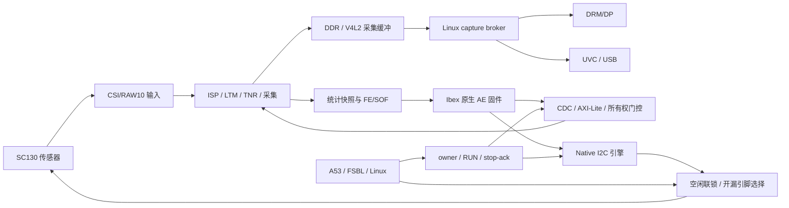

# Ibex 主控 ISP、共享图像缓冲与 QSPI 固化完整研发报告

**报告日期：2026-10-31｜工程基线：ISP Master v3 + QSPI v3｜目标器件：XCZU4EV-SFVC784-2-I**

工程根目录：`E:/workspace/AI_Projects/RISC_V/ibex`。本文依据现有源码、冻结清单、仿真报告、实板记录和烧录证据编写。本次编写报告没有重新运行硬件测试；“已验证”均指下文引用的既有记录，板卡最后状态是对应测试时的快照。

## 1. 项目成果与边界

项目已将 Ibex 从陪跑、自检和统计观察单元升级为真实 ISP/传感器 AE 主控。Ibex 读取 RAW10 统计及帧事件，经独立 I²C 引擎调整传感器曝光和细增益；A53/Linux 保留系统启动、视频采集、显示、USB 与控制权交接职责。生产启动镜像不加载 R5 程序，实板检查两颗 R5 核均为 No Power。

当前成果包括：

1. 可综合的 Ibex small 集成、256 KiB 程序存储和 256 KiB 数据存储、真实 ISP 访问、所有权隔离和传感器控制。
2. RV32 原生 AE 固件，含帧中断、统计一致性检查、写后读回、故障记录及安全停止。
3. V4L2 DMA-BUF 图像缓冲共享：采集缓冲供 DP 与 USB 使用，避免默认路径中的 A53 整帧复制。
4. 已完成综合、布局布线、bitstream/LTX 生成及实板 AE、DP、USB 基础吞吐测试。
5. 已生成并烧写 QSPI 启动包，通过逐块回读、整片 Flash 哈希及 QSPI 系统复位启动验证，上电软件流程包含自动 Ibex 接管。

当前不能宣称全部功能完成签核：USB 持续流有真实缓冲错误；物理断电上电尚未测试；I/O、CDC 和 MIPI 时序方法学仍有保留告警。AE 实物双向响应通过，不等于已完成全场景画质、极限光照和长时间可靠性认证。

## 2. 开发基线与技术选型

| 项目 | 当前实现 |
|---|---|
| SoC/FPGA | Zynq UltraScale+，`xczu4ev-sfvc784-2-i` |
| 顶层 | 冻结工程中的 `rtl/camera_top.v`，Vivado 顶层 `camera_top` |
| CPU | 上游 Ibex，经 `ibex_small_core` 包装；不修改上游 CPU RTL |
| 指令/配置 | RV32I、快速乘除、压缩指令；固件 `rv32imc_zicsr`；FF 寄存器堆 |
| 关闭的可选特性 | ICache、PMP、SecureIbex、分支预测；当前板版未开启 OpenTitan 外设分支或 PS 动态固件 loader |
| Ibex/lite 时钟 | 100 MHz；视频域沿用平台配置 |
| 程序/数据存储 | 各 256 KiB，板版使用 UltraRAM；小 BRAM 保存紧凑启动镜像 |
| 传感器接口 | 16 位寄存器地址、8 位数据的硬件 I²C；板级 ID 读回 `0130` |
| AE 策略 | 目标 96，死区 ±8，曝光/增益限幅和四 FE 等待 |
| 视频输出测试 | 1280×1024 YUY2，约 120 帧/秒，DP 与 UVC |
| 开发工具 | Vivado/XSim、hw_server、Vitis/Bootgen 2025.1；Linux 6.12；RISC-V GCC 13.2.0；WSL 辅助构建 |
| Flash | N25Q256AX1，JEDEC `20bb19`，32 MiB 单 NOR，64 KiB 擦除块 |

软件与 RTL 保持现有项目语言和风格：RTL 为 SystemVerilog/Verilog，Ibex 固件为 C/汇编，Linux 应用为 C，打包和构建采用 Python、POSIX shell、PowerShell、Tcl。没有为当前工程强制引入 `gen_top`。

## 3. 系统架构与职责划分



### 3.1 三类处理单元

| 单元 | 职责 | 明确边界 |
|---|---|---|
| A53 / PS | FSBL 初始化、Linux、采集驱动、DP/UVC、一次性 ISP/TNR 配置及交接工具 | 交接后不再与 Ibex 并发写传感器和 ISP 配置 |
| PL Ibex | 真实统计读取、FE/SOF 处理、AE 决策、ISP AE 使能及传感器曝光/增益更新 | 不承担图像帧搬运，不替代 Linux 视频栈 |
| R5 | 当前生产包不加载 R5 AE；实板为 No Power | R5 硬核没有从芯片中移除；以后启用其他 R5 工作必须遵守共享外设所有权 |

### 3.2 图像数据路径与控制路径

大吞吐图像仍在既有 CSI、ISP、DDR、V4L2、DP 和 USB 通路上流动。Ibex 只读取小规模统计和事件、写配置和传感器寄存器。二者解耦，使 AE 不需要 A53 对每帧执行控制循环，也不需要把整帧送入 Ibex RAM。

“DMA 代替 A53 搬运”的实际落地是复用既有 DMA 能力和 DMA-BUF：采集提供缓冲，DP/USB 导入同一缓冲，broker 延迟归还。此次没有新建一套 RTL 图像复制 DMA。默认共享路径避免的是应用层整帧 `memcpy`，不能据此推断所有内核/硬件路径绝对零复制，CPU 节省比例也尚未量测。

## 4. 源码目录结构与维护边界

下列结构给出当前有效入口；`build/` 下的源快照虽然处于构建目录，但冻结 v3 内有平台源码、软件及硬件配置，**不能把整个 build 目录视为可随意删除的缓存**。

```text
ibex/
├─ rtl/                         上游 Ibex CPU RTL
├─ vendor/                      lowRISC primitive 等依赖
├─ dv/ formal/ lint/ syn/        上游验证、形式验证、静态检查与综合基础设施
├─ ci/ util/ examples/ ...       上游工具、示例和辅助配置
├─ ibex_configs.yaml            CPU 配置定义
├─ *.core / src_files.yml       上游依赖与文件集描述
├─ integration/small/
│  ├─ rtl/                      Ibex 小系统、存储、ISP/传感器桥接
│  ├─ board/                    ZU4EV 板级封装、隔离拷贝、约束和构建脚本
│  ├─ ae_live/
│  │  ├─ ae_core.c/.h           可独立验证的 AE 策略
│  │  ├─ ibex/                  当前上板原生固件
│  │  └─ host/                  AE 宿主测试
│  ├─ boot/                     FSBL 重建、启动协调和 QSPI 打包
│  │  └─ tests/                 打包、启动顺序及 IIC guard 测试
│  ├─ sim/                      自检 testbench、传感器模型和运行脚本
│  ├─ opentitan/                可选 TL-UL 外设集成，当前板版关闭
│  ├─ tools/                    固件构建、仿真与诊断工具
│  ├─ ae/ board_validation/ sw/  早期移植/基础验证源码与测试镜像
│  └─ sources.txt               有序的 CPU/primitive 依赖清单
├─ build/
│  ├─ ae_live_test_image_v2/     已通过 E2E 测试的冻结固件镜像
│  └─ ibex_small/
│     ├─ ae_live/               当前原生固件构建产物
│     ├─ isp_master_v3_20261030/ 当前完整平台源快照和 Vivado 工程
│     │  ├─ rtl/                camera、capture、soc 等平台 RTL
│     │  ├─ isp/                AE 统计、LTM、TNR 等 ISP RTL
│     │  ├─ hardware/           IP/Block Design 等硬件配置
│     │  ├─ constraints/        板级、DDR 和接口约束
│     │  ├─ software/           Linux bridge、DMA-BUF broker、DP/UVC、Ibex固件副本
│     │  ├─ tools/              平台构建和配置脚本
│     │  ├─ project/camera.xpr   当前 Vivado 项目入口
│     │  ├─ reports/            实现、资源、时序检查报告
│     │  ├─ deliverables/       bit/LTX、ELF/MEM、Linux 可执行文件
│     │  ├─ source_manifest.json
│     │  └─ integration_manifest.json
│     ├─ qspi_v3_20261031/
│     │  ├─ fsbl-production/    生产 FSBL 源准备结果、ELF、map、清单
│     │  ├─ fsbl-ramtest/       RAM 启动验证 FSBL
│     │  ├─ production/         实际烧写的 BOOT/FIT/QSPI 镜像
│     │  └─ ramtest/            RAM 启动验证镜像
│     └─ board_reports/20261031_ae_usb/
│        ├─ BOARD_TEST.md       传感器、AE、DP/USB 实板结果
│        ├─ QSPI_PREP.md        RAM 启动、烧写、回读和 QSPI 重启证据
│        ├─ ae_light_observations.txt
│        ├─ usb_target_excerpt.txt
│        ├─ qspi_recovery_20261031.bin  烧写前完整恢复镜像
│        └─ qspi_expected_20261031.bin  烧写后完整预期镜像
└─ docs/
   ├─ implementation/          实现追踪
   ├─ verification/            验证、打包与 USB 问题分析
   ├─ superpowers/             规格和实施计划
   └─ reports/                 本报告与源码清单
```

### 4.1 三种“源”的区别

- `rtl/` 与 `vendor/` 是 CPU 和 primitive 依赖；本任务通过封装集成，没有把上游 CPU 改成 ISP 专用核。
- `integration/small/` 是本次可维护的集成源、固件、测试和打包入口。
- 冻结 v3 平台目录是原 ZU4EV 平台的隔离快照，含经过 patch 的真实相机顶层、ISP 端口、所有权和传感器引脚连接。修改平台必须通过拷贝/patch 流程重新生成并校验清单，不能只改某个临时 Vivado 生成文件。

原平台 `E:/workspace/AI_Projects/ZU4EV/zynq-zu4ev_platform` 在本轮保持只读。**QSPI 重建仍依赖该目录的 FSBL/BSP、PMUFW、ATF、U-Boot 和 Linux 种子，以及安装工具链；当前 Ibex 根目录尚不是完全脱离外部依赖的一键构建归档。**

## 5. 关键代码文件及功能

### 5.1 上游 CPU 代码

以下均位于 `rtl/`；可选模块存在于仓库不代表已启用。

| 文件/组 | 功能 |
|---|---|
| `ibex_pkg.sv`、`ibex_cheriot_pkg.sv` | 类型、常量及相关配置定义；后者存在不表示本项目开启 CHERIoT 功能 |
| `ibex_top.sv`、`ibex_core.sv` | CPU 顶层及取指、执行、访存、CSR 等模块连接 |
| `ibex_if_stage.sv`、`ibex_prefetch_buffer.sv`、`ibex_fetch_fifo.sv` | 取指、预取和指令缓冲 |
| `ibex_compressed_decoder.sv`、`ibex_decoder.sv`、`ibex_id_stage.sv` | 压缩指令展开、指令译码与执行控制 |
| `ibex_controller.sv` | 流水线控制、异常和中断控制 |
| `ibex_ex_block.sv`、`ibex_alu.sv`、`ibex_multdiv_fast.sv` | 执行、ALU、当前快速乘除实现 |
| `ibex_load_store_unit.sv` | load/store、字节使能、未对齐与异常处理 |
| `ibex_cs_registers.sv`、`ibex_csr.sv`、`ibex_counter.sv` | CSR、中断/异常状态、计数器 |
| `ibex_register_file_ff.sv` | 当前选择的寄存器堆实现 |
| `ibex_icache.sv`、`ibex_pmp.sv`、`ibex_lockstep.sv` 等 | 可选 CPU 特性，当前配置不启用 |
| `ibex_top_tracing.sv`、`ibex_tracer*.sv` | 仿真跟踪辅助，不是实际 AE 算法 |

### 5.2 Ibex 集成 RTL

统一路径前缀：`integration/small/rtl/`。

| 文件/模块 | 实际职责 | 当前板版状态 |
|---|---|---|
| `ibex_small_core.sv` | 固定 small 配置，包装 `ibex_top`；输出原生指令/数据握手、中断、alert、sleep | 使用 |
| `ibex_small_system.sv` | 连接 core/mem，地址路由至统计、ISP 配置和 sensor CSR；保存未完成事务目标、合并 IRQ、管理 CPU reset | 使用 |
| `ibex_small_mem.sv` | 程序/数据存储，紧凑 BRAM 启动图像拷贝至程序 URAM，完成前保持 CPU reset；提供 RAM 观察口和受限 mailbox 写入 | 使用 |
| `ibex_isp_snapshot.sv` | video→lite 统计快照、FE/SOF Gray 同步、pending IRQ 与读后 W1C 事件确认 | 使用 |
| `ibex_isp_cfg_cdc.sv` | lite↔video 单未决 native 请求/响应 toggle CDC；跨域时保持载荷稳定 | 使用 |
| `ibex_native_to_axi_lite.sv` | native→AXI-Lite 主机；AW/W 独立握手，B/R 完成才返回，传递 byte strobe 和错误 | 使用 |
| `ibex_isp_cfg_owner.sv` | PS/Ibex 双客户端缓冲、仲裁、所有权检查、owner/RUN/stop-token CSR；隔离非所有者，联锁安全回收 | 使用，开启传感器所有权扩展 |
| `ibex_sensor_ctrl.sv` | sensor CSR、tick、owner/RUN/stop 同步、ready/armed/fault/quiescent 生命周期、I²C 引脚选择的空闲联锁 | 使用 |
| `ibex_sensor_i2c.sv` | 16 位地址/8 位数据事务、重复 START、ACK/NACK、时钟拉伸、STOP、超时和开漏驱动 | 使用 |
| `ibex_small_loader.sv` | 可选 PS AXI 固件装载、读回和 RUN 控制，运行期阻止装载 | 当前关闭；开机依靠 bitstream 内置固件 |

### 5.3 板级连接、构建与约束

统一路径前缀：`integration/small/board/`。

| 文件 | 负责内容 |
|---|---|
| `ibex_board_debug.sv` | Ibex 板级实例、复位同步、真实 ISP/传感器端口、VIO/JTAG AXI 调试连接；启用统计、配置、native sensor 和 CPU-only reset。ILA 属于原平台硬件 IP 路径 |
| `prepare_ae_copy.py` | 生成隔离平台快照，patch camera/ISP/soc 引脚连接，打包 Linux 软件和固件工具，生成源/集成 manifest |
| `build_ae_board.tcl` | 把有序 Ibex 源和 native AE ROM 加入复制平台、建立 FPGA 工程；设置实际固件和启动字数 |
| `isp_snapshot_cdc.tcl` | 为 Gray 事件、统计载荷施加有界 max-delay/bus-skew，检查标记及对象有效性 |
| `isp_config_cdc.tcl` | 为配置请求/响应的 held payload 跨域路径建立相应约束 |
| `impl_init.tcl`、`eco_clock_gate.tcl`、`finalize_eco.tcl`、`prim_clock_gating_ultrascale.sv` | 实现流程钩子、UltraScale 时钟门控适配/ECO 支持；具体启用以冻结构建脚本为准 |
| `report_routed.tcl`、`report_ae_routed.tcl`、`report_ae_full_checks.tcl` | routed 资源、时序、CDC/DRC/方法学等报告生成 |
| `read_signatures.tcl`、`read_validation.tcl`、`read_r5_health.tcl`、`ram_boot_and_capture.tcl` | 签名、CPU/板级状态读取及历史调试流程 |
| `ISP_MASTER.md` | 当前 native 主控部署与交接契约；优先于早期观察/陪跑说明 |

`build_ae_board.tcl` 的默认旧拷贝路径仍为 `build/ibex_small/ae_board`。重建当前工程时应显式设置 `IBEX_BOARD_COPY` 或指定新的隔离目录。部分旧诊断脚本引用已清理的历史输出，不能直接把它们当成当前交付入口。

### 5.4 平台相机与 ISP RTL

统一前缀：`build/ibex_small/isp_master_v3_20261030/`。下列为平台功能分工，不表示本轮重新设计了全部 ISP 算法。

| 文件/目录 | 功能 |
|---|---|
| `rtl/camera_top.v` | 平台总连接；加入 Ibex debug、真实统计、配置所有权与传感器控制连接 |
| `rtl/soc/soc_subsystem.v` | PS/PL 外设连接及传感器 IOBUF；在 PS 与 Ibex 的“拉低/释放”信号间实现独占选择 |
| `rtl/sc130_camera_top_v2.v`、`rtl/csi_control.v`、`rtl/camera_reset.v` | 相机数据链、CSI 控制与复位协调 |
| `rtl/capture_axi_regs_v2.v`、`capture_frame_gate.v`、`capture_phase_gate_v2.v` | 采集配置、帧/相位门控 |
| `rtl/capture_source_clock_v2.v`、`capture_monitor.v`、`vdma_write_guard_v2.v` | 采集源时钟、监测与 VDMA 写入保护 |
| `rtl/tnr_memory_bridge.sv` | TNR 与外部存储数据接口连接 |
| `isp/isp.v`、`isp/isp_capture_frontend.sv` | ISP 总连接和采集前端；向 Ibex 导出真实统计和事件 |
| `isp/ae/ae_stats_raw10.sv` | RAW10 的 ROI/像素统计、均值及结果有效性信息；AE 的测量来源 |
| `isp/raw10_to_yuy2.v`、`isp/sc130_tonemap_yuy2.v` | RAW10 到显示/输出数据的格式及 tone-map 处理 |
| `isp/ltm/isp_axi_regs.sv` | 真实 ISP AXI-Lite 寄存器、shadow/active 配置和相关状态 |
| `isp/ltm/ltm_camera_ingress.sv`、`ltm_processor.sv` | LTM 输入组织及处理 |
| `isp/ltm/bilateral_kernel.sv`、`bilateral_layers.sv`、`unsigned_divider.sv` | LTM 算术/滤波组件 |
| `isp/tnr/tnr_core.sv`、`isp_tnr_node.sv` | 时域降噪核心和 ISP 节点连接 |
| `isp/tnr/tnr_axi_regs.sv`、`tnr_ddr_bist.sv` | TNR 寄存器及 DDR 自检 |
| `hardware/`、`constraints/` | IP、时钟、PS/PL 及接口配置；板级和 DDR 约束 |

### 5.5 当前 AE 固件

统一前缀：`integration/small/ae_live/`。

| 文件/函数 | 功能 |
|---|---|
| `ae_core.h` | `ae_core`、`ae_update` 和曝光/增益更新类型定义 |
| `ae_core.c / sc130_ae_core_init` | 从真实曝光、VTS、细增益建立 AE 状态和最大曝光 |
| `ae_core.c / sc130_ae_core_propose` | 根据有效的新统计提出更新；死区、四 FE holdoff、比例限幅、曝光/增益优先级 |
| `ae_core.c / sc130_ae_core_commit` | 仅在实际 I/O 成功后提交算法状态，防止失败写入污染内部状态 |
| `ibex/main.c / main、start_session` | 等待新 RUN 授权、检查所有权与能力，验证 sensor ID、stream、VTS/曝光/增益，开启 ISP AE |
| `ibex/main.c / ae_irq_handler` | 处理 cause17，扩展 FE 计数，读取/确认 pending，发布帧事件 |
| `ibex/main.c / statistics、run_session` | seq 前后校验统计、等待时序窗口、执行 AE 更新和写后读回、检查跨帧与停止请求 |
| `ibex/main.c / fault_stop、ae_trap_handler` | 记录错误、清成功签名、报告 fault 并停止后续控制 |
| `ibex/board.h` | MMIO 地址、状态/错误枚举、mailbox 与 512 条记录结构 |
| `ibex/start.S` | sp/gp、data/bss 初始化，256 字节对齐向量表、完整中断保存/恢复、`mret` |
| `ibex/link.ld` | ROM/RAM/data/bss/stack 布局与栈空间断言 |
| `ibex/runtime.c` | 无操作系统环境需要的 `memcpy/memset` |
| `main.c`、`ae_platform.h` | 抽象平台移植/宿主路径；不是当前原生上板入口 |
| `host/test_ae_core.c`、`test_ae_loop.c`、`test_port.c` | 算法、控制循环和移植契约测试 |

细增益使用 `0x20..0x3f`，最大曝光编码为 `(VTS−4)×16`，曝光按 16 对齐。单次候选更新约束在当前值的 `3/4..5/4` 区间。暗场优先增加曝光，曝光到顶后增加增益；亮场存在额外增益时先减增益。算法不使用未证实的 sensor group-hold 序列。

### 5.6 Linux 视频与共享缓冲代码

统一前缀：冻结 v3 的 `software/`。

| 文件 | 职责 |
|---|---|
| `platform_bridge.c` | 主运行程序，组织 V4L2 采集、最新帧策略、DP/USB 事件、输出 QBUF/DQBUF 和缓冲归还；默认共享 DMA-BUF 路径，记录各类 USB 错误 |
| `capture_broker.h` | `queued/latest/dp/usb` 所有权状态；独立记录 DP 与 USB hold，二者完成前不归还采集 |
| `uvc_core.c/.h` | UVC probe/commit 与会话控制、帧策略、节拍及序号判断；实际 V4L2 输出排队/完成处理位于 bridge |
| `dp_display.c/.h` | DRM/DP 缓冲导入、提交、翻页完成及旧显示缓冲释放 |
| `dual_core.h` | 双采集通道的 buffer/generation/epoch/序号归并、时间戳和计数回绕辅助算法；文件名不表示当前有 R5 AE 在运行 |
| `perf_stats.h` | 延迟、CPU 等性能统计与 log2 直方图；分位值为桶上界，错误分类计数由 bridge 记录 |
| `isp-control/ispctl.c` | PS 侧 ISP 参数、曲线、apply/commit 和 RAW10 stats 工具；自动启动只在交接前执行 |
| `tnr-control/tnrctl.c`、`isp-tnr-startup.sh` | TNR 参数、DDR 校准及内存测试；脚本等待 bridge 统计，完成一次性 LTM/TNR 配置后退出 |
| `dp_smoke.c` | DP 独立冒烟工具 |
| `ibex_isp_handoff.c` | Linux `status/start/stop`；预检 IIC 时钟、复位、idle、ISP commit 与固件准备状态，执行安全交接/回收 |
| `Makefile`、`tests/` | 静态 AArch64 应用构建和九项软件验证 |
| `ibex-ae/` | 原生固件及独立重建工具的封装副本 |
| 旧 `r5-ae/`、GPIO sensor 工具（若源快照中存在） | 参考/历史源码，不是当前生产执行入口；旧 GPIO sensor 工具不可用于 v3 的硬 IIC 引脚 |

#### 缓冲生命周期

```text
capture QBUF → DMA 写入 → DQBUF → 成为候选/最新帧
                                  ├─ DP hold → page-flip 完成 → DP release
                                  └─ USB hold → 输出 DQBUF 完成 → USB release
两侧均无 hold、且不再是 latest → 允许重新 capture QBUF
```

保留“仍在显示”和“仍被 USB 读取”的独立 hold，避免采集重用造成读写重叠。sequence-marker/static 等诊断模式仍可使用复制路径，不应把诊断模式的行为与默认 DMA-BUF 路径混淆。

### 5.7 FSBL、Linux 启动与 QSPI 打包

统一前缀：`integration/small/boot/`。

| 文件 | 功能 |
|---|---|
| `build_ibex_qspi.ps1` | 总打包入口；构建生产/RAM FSBL、Linux IIC 准备工具，生成 BIF 并调用 Bootgen 生成 BOOT，再调用 Python 构建 overlay/FIT/QSPI；不连接或烧写板卡 |
| `prepare_ibex_fsbl.py` | 将平台生成的 FSBL/BSP、当前 sensor 硬 IIC 源与官方 XIicPs 驱动组合成独立准备目录；生产/RAM 变体受控生成 |
| `build_ibex_fsbl.ps1` | 裸机 AArch64 编译/链接、OCM 布局检查、ELF/map/symbols/源清单输出 |
| `sc130_iic_clock.c` | FSBL 早期核对 IOPLL 源、整数模式、FBDIV、DIV2 与锁定；配置 100 MHz IIC0 参考时钟并仅释放其 reset |
| `ibex_iic_prepare.c` | Linux 启动前守卫：确认 PS owner/RUN0、无 Linux IIC 驱动且时钟有效；必要时只释放 IIC0 reset，不写 sensor 寄存器 |
| `start-ibex-platform.sh` | bridge 启动→同步等待 ISP/TNR 配置完成→检查 bridge 存活→IIC 准备→单次 handoff；失败明确日志，部分交接失败请求安全 stop，不强夺控制权 |
| `package_ibex_qspi.py` | 输入身份/大小校验、cpio/gzip 解析与 overlay，消费已有 BOOT、构建 FIT/组合 QSPI，提取 payload 核对哈希，检查 Flash 布局并输出 manifest |
| `tests/test_package_ibex_qspi.py` | 归档、多流、设备节点冲突和容量边界 |
| `tests/test_startup.py` | 顺序、成功、PS profile 失败、bridge 死亡、handoff 失败及回收行为 |
| `tests/test_iic_prepare.c` | Linux IIC reset-only 守卫 |
| `tests/test_fsbl_iic_clock.c` | FSBL PLL/分频/锁定/复位准备的成功与拒绝路径 |

原生产预编译 FSBL 实际仍使用 GPIO bit-bang，不适配 v3 引脚。项目没有直接沿用该 ELF，而是保留已验证的 DDR/USB/DP/PS 初始化和 BSP，替换 sensor 路径并加入官方 XIicPs。IOPLL 条件为 33.333333 MHz 参考、FBDIV90、DIV2；以 15/1 分频得到 100 MHz，出现未知 PLL 状态时 fail-stop。

原 rootfs 有一个真实 cpio 流、433 条记录。打包保留原 gzip 字节并追加 overlay；静态补 `console 5:1` 和 `null 1:3`。不硬编码 `ttyPS0`：目标内核动态分配为 `235:0`，由 `/init` 先挂 devtmpfs 再使用 tty。

### 5.8 仿真和基础验证文件

统一前缀：`integration/small/sim/`。

| 文件组 | 覆盖内容 |
|---|---|
| `tb_ibex_small.sv`、`ibex_small_mem_check.sv` | CPU 指令执行、存储边界、掩码、错误响应 |
| `tb_uram_cpu.sv`、`tb_uram_loader.sv`、`tb_ibex_loader.sv` | URAM 启动、CPU 访问、观察口与可选 loader |
| `tb_isp_snapshot.sv`、`tb_isp_cpu.sv` | 真实统计/FE/SOF 的快照和 CPU 中断访问 |
| `tb_isp_config_protocol.sv`、`tb_isp_config_cpu.sv` | CDC、AXI-Lite、所有权、背压及 CPU 配置 |
| `tb_sensor_i2c.sv` | 地址/数据 ACK/NACK、重复 START、SCL 拉伸、STOP、超时 |
| `tb_sensor_ctrl.sv`、`tb_sensor_owner.sv`、`tb_sensor_handoff.sv` | 空闲保护、CPU reset drain、arm、stop-token、提前回收和停钟场景 |
| `sc130_sensor_model.sv`、`tb_sensor_model.sv` | 线级行为 sensor 模型及其自检 |
| `tb_ae_live_system.sv` | 真实 Ibex+生产固件+ISP 寄存器/统计+sensor 模型端到端 |
| `tb_board_validation.sv`、`tb_ibex_ae.sv` | 板级基础/早期 AE 移植阶段验证 |
| `run_*.ps1/.tcl`、`make_isp_config_cpu.py` | 有界运行、准备测试固件及检查 PASS/Fatal/Error |

`integration/small/opentitan/` 的 bridge、GPIO、timer、UART、I²C 等外设有独立验证，但当前 AE 主控 bitstream 的 `EnablePeripherals=0`，不可将这些外设写成当前 sensor 的控制通路。

## 6. 地址空间、寄存器和诊断契约

### 6.1 地址映射

| 访问者/地址 | 对象 |
|---|---|
| Ibex `0x00100000..0x0013ffff` | 256 KiB 程序存储；复位入口 `0x00100080` |
| Ibex `0x00200000..0x0023ffff` | 256 KiB 数据 RAM；链接器为普通 data/bss/stack 分配前 240 KiB |
| Ibex `0x0023e000` | 固定 mailbox；512 条日志环的实际地址由 ELF 符号定位，不是简单假定紧跟 mailbox |
| Ibex `0x50000000..0x5000007f` | 统计、FE/SOF、pending 快照窗口 |
| Ibex `0x51000000..0x5100ffff` | 真实 ISP 配置窗口，保留平台 16 位偏移 |
| PS `0xa0040000` | 同一 ISP 的 PS 基地址 |
| Ibex `0x52000000..0x520000ff` | native sensor CSR |

### 6.2 ISP 所有权控制

| 偏移 | 作用 |
|---|---|
| `+0xff00` | owner bit0：0=PS，1=Ibex；复位默认 PS，仅 PS 可写 |
| `+0xff04` | 状态：quiescent、grant、busy、armed、fault、restart-required、boot-ready、SCL/SDA、stop-ack |
| `+0xff08` | bit0 RUN；bit1 只读回显 stop request token。PS 写 RUN0 时由硬件生成 token，不由软件写 bit1 |
| `+0x0248` | 平台 AE enable，固件执行写入和读回 |

非所有者普通配置访问返回错误，不会送达 ISP。PS 安全回收不仅看 owner：必须先 RUN0，等待当前字节组/读回完成及匹配 stop-ack、quiescent，再回收。旧文档“PS 可随时回收”不适用于当前启用 sensor ownership 的生产配置。

### 6.3 快照与 sensor CSR

| 窗口 | 主要偏移 |
|---|---|
| Snapshot | `08 seq`、`0c frame`、`10 mean`、`14 count`、`18/1c sum`、`20 valid/busy/active`、`24 region/black`、`28 bad`、`2c overrun`、`30/34 x/y`、`38/3c w/h`、`40 FE`、`44 SOF`、`48 pending/W1C`；00/04 保留 |
| Sensor | `00 ID=53454e31`、`04 ticks`、`08 事务/会话标志`、`0c half-period`、`10 command`、`14 regaddr`、`18 TX写/RX读`、`1c 固件生命周期/状态` |

每次快照读取触发新快照，整组 CSR 不在一次读后永久冻结。固件需要前后读取 seq 并验证一致，不能只把多个独立读值拼接为“同一帧原子记录”。pending 的 W1C 只确认最近一次 pending 读所观察到的事件，后续新事件继续保留。

mailbox magic 为 `49414531`，状态为 WAITING=1、STARTING=2、RUNNING=3、STOPPED=4、FAULT=5。成功初始化签名 `600dae01` 仅证明 sensor/ISP 初始化完成；需要结合帧推进、实际寄存器更新和画面统计判断闭环行为。fault、mcause、mepc、session、changes 等用于现场分析。

JTAG host 的受限 input mailbox 写入区为 `0x0023f000..0x0023f7ff`；`0x0023e000` 是 CPU 输出诊断区，二者不应混为一处控制输入。

## 7. 所有权、CDC、复位和实时行为

1. **事务完成点**：native 以 `req&&gnt` 接受；AXI 写等 B、读等 R；响应背压期间保持稳定，AW/W 允许任意先后顺序。
2. **CDC**：统计和配置采用稳定载荷与 toggle 握手；Gray FE/SOF 计数经同步器。约束通过对象标记定位，不靠固定层次名，避免泛化 false-path 掩盖载荷时序。
3. **引脚独占**：PS 与 Ibex 仅能拉低或释放 SCL/SDA，不主动驱高。控制权切换要求双方输出释放、物理线连续高、事务 idle 达 500 lite 周期，即 5 µs。
4. **I²C 速率与超时**：最小半周期 125 个 100 MHz 周期，名义上限 400 kHz；事务超时 1,000,000 周期，即 10 ms。名义数字不代替示波器电气测量。
5. **RUN0**：允许固件完成当前曝光双字节及读回，再发布 quiescence；不能在第一字节完成后提前归还。
6. **stop token**：pending 请求期间重复 RUN0 幂等，RUN1 被拒绝，直到匹配 ack 完成；解决旧状态和 token ABA。
7. **CPU-only reset**：撤销 arm/ready，但独立 I²C 引擎继续已接受事务直到 STOP/timeout；新 CPU 必须见 RUN 低再高才能重新授权。
8. **全局 reset**：需要同时覆盖跨域两端；若视频时钟停止，已有 snapshot/config 事务可能一直等待，当前没有通用取消/恢复协议。

CPU reset 若发生在两字节曝光写入中间，sensor 可能留下部分值；重新启动会读取实际 sensor 状态，不假定中断前候选已经完整应用。软件 FE/SOF 检查也不能证明传感器内部实际曝光锁存边界或两字节物理原子性。

## 8. 构建、启动与固化流程

### 8.1 FPGA 与原生固件

```sh
source /mnt/d/development/rtl/env.sh
bash integration/small/tools/build_ae_live.sh
python integration/small/board/prepare_ae_copy.py --destination <新的隔离目录>
```

随后设置 `IBEX_BOARD_COPY`，在 Vivado 2025.1 中运行 `build_ae_board.tcl`，完成综合、实现、时序/约束检查、bit/LTX 导出。显式有序源清单和 XPM 配置必须保留。冻结固件 text=5488 B、data=0、bss=26660 B，紧凑启动图像为 1371 个 32 位字。

对已验证的冻结 v3，可在 `software/` 使用：

```sh
make OUT=build-aarch64 CC=aarch64-linux-gnu-gcc LDFLAGS=-static all
make OUT=build-host test
```

不应把新构建输出覆盖为旧冻结版本后仍沿用旧哈希；任何源码修复都需重建相关产物并形成新的 manifest。

### 8.2 QSPI 生产镜像构建

```powershell
./integration/small/boot/build_ibex_qspi.ps1
```

可覆盖 `-Platform`、`-Bundle`、`-OutputDirectory`、`-Bootgen`。工具需要 Windows AArch64 裸机 GCC、Bootgen 2025.1、WSL AArch64 Linux GCC、Python、mkimage/dumpimage/fdtget，以及安装的官方 `iicps_v3_21` 驱动。

生产 BIF 包含 FSBL、PMUFW、bitstream、BL31、U-Boot，不含 R5 分区。内核和 DT 沿用验证种子。生产/RAM FSBL 准备树仅 `xfsbl_qspi.c` 不同；RAM FSBL 在 `Sc130RamBootReady=0xfffc3928` 等待测试镜像，不能烧成生产 FSBL。

### 8.3 自动启动时序

```text
BootROM / QSPI
 → 生产 FSBL / PS与DDR初始化
 → 加载 v3 PL / IIC0 100MHz准备
 → sensor standby配置与读回 / pipeline启动 / stream-on / SENSOR_READY
 → ATF/BL31、U-Boot（PMUFW 提供电源管理等服务，并非此处再串行执行的一层）
 → 从 QSPI 0xc00000 读取 FIT / 启动 Linux
 → /init 挂 proc、sysfs、devtmpfs
 → start-ibex-platform.sh
 → 启动 bridge（采集/DP/USB）
 → 同步执行并等待一次性 ISP/TNR profile 完成
 → 检查bridge存活 / IIC reset准备
 → ibex_isp_handoff start --ps-writers-stopped
 → handoff命令完成 / IBEX_STARTUP_OK
 → 固件完成会话初始化，另以mailbox状态/签名/记录推进验证AE RUNNING
```

Linux 原来并发启动 bridge 与 ISP/TNR 脚本，本次用单一协调器明确等待 PS 配置完成。交接失败会记录日志并请求有界 stop/reclaim，未完成时保持 PS/R5 writer 停止，不自动重复 start，也不强制回收。

`IBEX_STARTUP_OK` 是协调器完成交接命令的标记，不能单独代替固件 RUNNING、fault=0、初始化签名和真实帧推进的联合检查。

### 8.4 手工诊断和停止

板端以 root 执行：

```sh
cat /tmp/ibex-startup.log
cat /tmp/isp-tnr-startup.log
tail /tmp/sc130-platform.log
/usr/bin/ibex_isp_handoff status
/usr/bin/ibex_isp_handoff stop
```

再次 start 前必须确认所有 PS/R5 sensor/ISP writer 停止、视频时钟继续运行、commit 完成。交接工具本身不负责启停 R5，不修改 sensor 模式表，也不能识别任意第三方程序是否在访问外设。

## 9. QSPI 布局、产物和版本身份

| 项目 | 地址/大小 |
|---|---|
| Flash 总容量 | 33,554,432 B / 32 MiB |
| BOOT 区 | offset 0，必须小于 `0x00c00000` / 12 MiB |
| 生产 BOOT.BIN | 9,095,472 B |
| FIT 区 | offset `0x00c00000`，上限 20 MiB |
| 生产 image.ub | 15,756,124 B |
| 组合 QSPI_LINUX.bin | 28,339,036 B |
| 擦除终点 | 28,377,088 B / `0x01b10000` |
| 原尾保留 | 擦除终点之后 5,177,344 B |
| Flash 写入暂存 DDR | `0x32000000`，处于平台保留区域 |
| RAM 测试 BOOT / FIT | `0x30000000` / `0x10000000` |

冻结输出目录：`build/ibex_small/qspi_v3_20261031/production/`。

| 产物 | SHA-256 |
|---|---|
| `camera_top.bit` | `45739aa4e12954a3060acf23f4f36f4656c28e1e3e1464ca4d7d77cb474fac54` |
| `camera_top.ltx` | `6155de4d889944cbf5c8795ad30be6ad5025a4439d28327e1ea49cfa11069952` |
| 原生 `ae_live.mem` | `f9995b9a4592630498684a0b271371fc41e23c4c69970aaacb9d711dc9c2e33b` |
| 生产 FSBL ELF | `4ad2b98b8cc33c4fda6052aa0c4bf70998f12788e9bc8dc2109ba28de87a0168` |
| 生产 `BOOT.BIN` | `5ad1efe24f535d9f08dbcf8f00984fcbb368ab6442e141d39f454be5ba63058c` |
| `image.ub` | `46fc6c2b371e4f59ae9cde098a17b85ef5b680a1bf687aaafe68be17188851ad` |
| `QSPI_LINUX.bin` | `929ebbf1118ccd9abefe6c0a8a4c5aa48b38e3f57678a47dba1a0fb6bef4cc74` |
| 烧写后完整 32 MiB Flash | `aacad06b005d05cdfaee342c18c556293c9a7c390b81c7a7f5ac11ad0d33b94e` |
| 烧写前完整恢复镜像 | `24c0e6c1a6071fd2d2d9742db27d91c8f590de24505c8c916bc2a554c46c90be` |

组合镜像哈希不同于完整 Flash 哈希是正常的：完整校验还包含擦除补齐的 FF 和原尾区。FSBL 使用 `__DATE__/__TIME__`，重新编译会改变 ELF 身份，首编或历史 README 哈希不能替代最终冻结清单。

## 10. 验证方法与结果

### 10.1 分层验证矩阵

| 层次 | 覆盖范围 | 结果及证据边界 |
|---|---|---|
| CPU/存储 | 真实 CPU 执行、边界、字节掩码、非法地址、ROM 写保护、URAM 启动 | 基础/URAM 自检通过，不是完整 ISA 合规认证 |
| ISP snapshot/config | 真实寄存器、统计/FE/SOF、IRQ、CDC、AW/W 顺序、背压、非 owner 错误 | XSim 通过 |
| I²C leaf | 写、重复 START 读、多个 NACK 位置、拉伸、超时、STOP | 自检通过 |
| 生命周期/所有权 | 5 µs idle、CPU reset drain、重新 arm、旧 q、stop-token、消费者停钟 | 自检通过 |
| AE 端到端 | 真实 Ibex+生产固件+真实 ISP 寄存器+线级模型；暗增亮减、RUN0 处于曝光首字节 | 4 次字节写、24 次读、2 次调整；完整字节组/读回后回收通过 |
| 故障注入 | sensor NACK、无帧 | 故障清签名并停；无帧场景使用 timer 跳变注入，不代表实测 1 秒等待 |
| AE 宿主 | 算法、循环、port 三项 | 通过 |
| Linux 视频软件 | broker/DP ownership/events/snapshot/marker/completion/performance/shared buffer 九项 | 通过 |
| QSPI 离线 | 6 项归档/布局 + 6 项 startup、两项原生 C guard、shell syntax、FIT 提取/hash | 通过 |
| FPGA 实现 | 综合、布局布线、bit/LTX | 成功；保留约束和方法学告警 |
| 实板控制 | sensor ID/模式、真实统计、AE、stop/start、R5状态 | 通过，详见下文 |
| USB/DP 实板 | 共享 DMA-BUF 持续流与 DP | 吞吐成立，但 USB buffer errors 非零 |
| QSPI | 完整 RAM boot、写前 DDR 回读、Flash 逐块/整片校验、系统复位从 QSPI 启动 | 通过；物理断电冷启动未测 |

仿真判定同时要求 PASS 标记且无 Fatal/Error；Vivado 进程 exit0 不能单独作为通过依据。

### 10.2 FPGA 资源与时序

| 指标 | 结果 |
|---|---:|
| LUT | 49,216 / 87,840，约 56.03% |
| BRAM | 96.5 / 128，约 75.39% |
| URAM | 36 / 48，75% |
| DSP | 71 / 728，约 9.75% |
| Routed nets | 103,163 / 103,163 |
| Routing errors / blackboxes | 0 / 空 |
| WNS / WHS | +0.174 ns / +0.010 ns |
| TNS / THS | 0 / 0 |
| Pulse-width slack | +0.143 ns |

实现使用 jobs=1、maxThreads=1。Ibex 四类 CDC max-delay 生效，Gray/payload/config request/config response 的记录 slack 分别为 +1.893/+8.318/+3.787/+9.399 ns；sensor 同步相关路径最差记录约 +3.314 ns。

最终 bus-skew 报告未见 VIOLATED，但存在共同优化源导致部分 routing-stage skew 分组忽略的告警，仍需逐位覆盖复核。DRC 有 122 条 Warning，CDC6 类 6 条、CDC15 类 148 条；camera I²C/MIPI 等存在缺 I/O delay，MIPI TIMING24 约束被 clock-group/false-path 覆盖，以及 TIMING28。这些限制不能由“WNS 为正”自动消除。

### 10.3 实物 AE 和交接

传感器 ID `0130`、stream=1、模式寄存器检查通过。固件 state=3、fault=0、signature=`600dae01`，帧事件/记录持续推进。稳定场景初始曝光从 `0x20d0` 调低至 `0x0930`，均值约 98；stop 完成后 owner=0/RUN0，再次 start 成功进入第二 session。

用户遮挡并放开镜头，持续采样捕获：

| 场景样本 | 亮度均值（十进制） | 曝光编码 | 细增益 |
|---|---:|---|---|
| 遮挡前 | 98 | `0x0970` | `0x20` |
| 遮挡 | 4 | `0x20d0` | `0x3f` |
| 放开后 | 97 | `0x0b00` | `0x20` |
| 第二次遮挡 | 4 | `0x20d0` | `0x3f` |
| 第二次放开 | 102 | `0x0cd0`，随后 `0x0bb0` | `0x20` |

这些是一秒级、字段顺序读取的非原子样本，足以证明双向调节响应，不能据此给出毫秒级闭环延迟。512 条环在约 120fps 下只覆盖约 4.3 秒，现场分析需持续保存记录。

PS 侧独立 sensor 复读曾因 SR=`0xa0` 未满足严格 FIFO 前置检查而被工具拒绝，未清 FIFO、未执行该次读。固件自身每次更新的写后读回成功；二者必须区分。

### 10.4 USB/DP 与已知错误

Windows 枚举 UVC 正常。FFmpeg 以 1280×1024 YUY2/120fps 采集 10 秒，收到 1199 帧；设备默认日志确认 shared DMA-BUF，采集/DP 约 120fps、invalid=0。

但首轮持续流出现 3 次 `USB_ERR_BUFFER`，flags=`0x4040`、bytesused=0，发生在 STREAMOFF 之前；后续流累计错误继续增加，某次快照为 65。此时 owner/DQ/event/send 分类错误为 0。不能将其归为正常停流取消或称 USB 无错误。

Linux 6.12 源码行为与 UVC DROP_INCOMPLETE、等时请求 `-EXDEV` 一致，但缺目标内核 trace 和补丁对应证据，底层 DWC3/USB 根因没有定论；没有修改应用错误计数来隐藏问题。尚未测图像完整性、USB 重连、长时间错误率、CPU 占用及功耗降低。

### 10.5 QSPI 烧录和复位启动

先保存并核对旧整片恢复镜像，再验证生产/RAM 同源 FSBL、完整 RAM BOOT/FIT 和目标 DDR 回读哈希。首次 JTAG 上传被 hw_server channel close 中断，重新连接后完整重传/回读，不把中断过程当成成功。

RAM 启动看到 IIC0 100 MHz、sensor ID/模式与 `SENSOR_READY`，新 FIT 启动后 `IBEX_STARTUP_OK`、真实 AE/DP 正常。生产包暂存 DDR 并全量回读匹配后执行 Flash 写入，工具返回：

```text
ZUMINI_QSPI_BOOT_WRITE_READBACK_OK bytes=28339036 erase_bytes=28377088
FLASH_EXIT:0
```

随后 `/dev/mtd0` 全片 SHA 与“新包+FF擦除补齐+原尾”完全一致。BOOT_MODE 从测试覆盖值 `0x2102` 恢复为 `0x2`，系统复位后生产 FSBL 从 QSPI 读取分区、U-Boot 从 `0xc00000` 读取 FIT，自动 sensor 初始化和 Ibex 接管再次成功。IRQ `0xa8f→0xc2f`、记录持续推进，DP/采集约 120fps、invalid=0，R5 双核 No Power。

本次是 XSDB system reset，不是物理断电上电；报告不把它写成已完成断电冷启动。该复位检查中 USB 没有主机取流，因此也不构成 USB 错误已消失的证据。

## 11. 研发过程中的关键问题与解决

| 问题 | 原因与修复 | 验证 |
|---|---|---|
| IRQ17 进入后寄存器破坏、异常 store | Ibex `mtvec` 为固定 vectored，早期直接入口假设错误；改为 256 对齐、32×4 字节向量表和完整 handler | 反汇编核 slot17，真实 CPU E2E 通过 |
| RUN1→RUN0 快速切换提前回收 | 旧 quiescent 值被误用 | arm 清状态、匹配 stop ack/pending，复现后修复测试通过 |
| 重复 RUN0 引起 token ABA | 消费者停钟时重复 toggle | pending 期间幂等、拒绝新 RUN1，相关停钟测试通过 |
| CPU-only reset 中断 sensor 事务 | CPU 生命周期与传输引擎必须分离 | 已接受事务 drain 到 STOP/timeout，撤销 arm 并要求新会话 |
| 裸机固件链接缺 runtime | 编译器/结构复制需要 memcpy/memset | 加 freestanding runtime，固件及封装重建通过 |
| 仿真没有观察到曝光更新 | 模型 SOF→FE 窗口过短，固件正确跳过不安全时窗 | 调整模型窗口，不放宽生产检查，再验证暗/亮更新 |
| 旧 FSBL 与 v3 引脚不匹配 | 预编译 ELF 仍 GPIO bit-bang，不能由新版源码 README 推定二进制行为 | 反汇编确认，重建 PS IIC0 FSBL，RAM 和 QSPI 启动通过 |
| Linux 阶段 IIC0 reset 被断言 | 原平台启动到 Linux 后的真实状态 | 添加受限 reset-only 准备，保留 handoff 原有预检 |
| 启动时 PS profile/交接竞态 | 原 init 并发启动配置脚本 | 顺序协调器等待 profile 完成后单次 start |
| initramfs 设备节点和归档误判 | 原字节串 TRAILER 计数不能证明流数，tty major 非固定 | 按结构解析、保原 gzip、补 console/null，tty 使用 devtmpfs |
| 工程历史产物混杂 | 旧工程、仿真缓存、上传副本重复 | 移出 148 项；保留冻结 v3/QSPI/证据/恢复镜像，交付哈希复核 |

## 12. 当前风险、后续任务与验收标准

| 优先级 | 待完成事项 | 建议验收标准 |
|---|---|---|
| P1 | USB 持续流 buffer errors 根因 | 对齐目标内核，捕获 request status/调度证据；修复后固定条件长测并统计错误率和图像完整性 |
| P1 | 真正断电上电验证 | 完全断电后恢复，自动 SENSOR_READY/IBEX_STARTUP_OK、帧推进、R5停机，无调试器代为继续 |
| P1 | 方法学/CDC/接口约束闭环 | 复核所有路径和 skew 位覆盖，给出适用 I/O 时序约束及每条告警处置证据 |
| P2 | Sensor 电气与曝光锁存 | 示波器测 SCL/SDA、拉伸、上升时间；核双字节更新的物理生效时刻 |
| P2 | 异常恢复和长时间运行 | I²C 卡线/NACK、CPU reset、视频停钟、USB重连、电源扰动下可控故障和恢复 |
| P2 | 性能收益量测 | 在相同帧率/输出条件比较 A53 CPU、内存带宽、延迟、功耗；区分默认与诊断复制模式 |
| P2 | 构建归档自包含 | 将外部平台种子、BSP/库、许可及工具版本纳入可追溯依赖包；干净环境重建验证 |
| P3 | 诊断工具维护 | 清理旧脚本对历史输出的硬编码引用，统一当前工程入口和日志时间戳 |

## 13. 文件清单、证据与交接说明

### 13.1 完整源文件清单

同目录附件 [2026-10-31-source-inventory.csv](2026-10-31-source-inventory.csv) 包含：

- `integration/small/` 当前集成源、固件、工具、测试、配置和配套文档；
- `sources.txt` 直接列出的上游 CPU/primitive 依赖；
- v3 `source_manifest.json` 明确列出的平台快照文件。

每项列出相对路径、分类、字节数和本次读取时的 SHA-256。它不递归列出整个 Vivado `.gen/.runs`、第三方仓库或所有上游示例；这些属于生成结果或非当前直接文件集。关键代码职责由第 5 节说明，原始文件身份由 CSV 和各构建 manifest 共同追溯。原始 source manifest 的源哈希与集成后文件可能不同，最终 patch 身份以 `integration_manifest.json` 为准。

OpenTitan 部分只列本工程适配与测试入口，不展开未启用的整套导入依赖。FPGA 实际编译文件集应以当前项目配置、`sources.txt` 和构建脚本为准；“出现在源码清单中”不代表已综合进生产 bitstream。

### 13.2 主要原始证据

| 记录 | 路径（相对工程根目录） |
|---|---|
| 原生主控部署契约 | `integration/small/board/ISP_MASTER.md` |
| 设计/实现追踪 | `docs/implementation/2026-10-30-isp-master.md` |
| 仿真与 FPGA 构建基线 | `docs/verification/2026-10-30-isp-master-baseline.md` |
| 实板 AE/DP/USB | `build/ibex_small/board_reports/20261031_ae_usb/BOARD_TEST.md` |
| 光照采样与 USB 摘录 | 同目录 `ae_light_observations.txt`、`usb_target_excerpt.txt` |
| QSPI 全流程 | 同目录 `QSPI_PREP.md` 和 UART/XSDB/flash 日志 |
| 启动包身份与验证 | `docs/verification/2026-10-31-ibex-qspi-package.md` |
| USB 未解问题 | `docs/verification/2026-10-31-usb-buffer-diagnosis.md` |
| 清理清单 | `docs/verification/2026-10-31-cleanup.json` |
| bit/LTX/软件冻结身份 | `build/ibex_small/isp_master_v3_20261030/deliverables/SHA256SUMS` |
| QSPI 身份/布局 | `build/ibex_small/qspi_v3_20261031/production/manifest.json` |

清理采用可恢复移出归档，永久删除请求被自动审批拒绝。截至最后一次代理执行记录，不能声称工程外归档已经永久删除；这不影响当前工程交付和板端 QSPI 内容。

### 13.3 交付结论

已交付的工程具备“PS 启动与初始化—Ibex 安全接管—真实统计驱动 AE—共享图像缓冲输出—QSPI 持久启动”的完整链路。最直接的下一步是物理断电启动测试、USB 错误闭环及约束签核。后续变更应沿现有 source/manifest/验证分层维护，避免只更新某个 ELF、bit 或 Linux 应用而失去系统版本对应关系。
