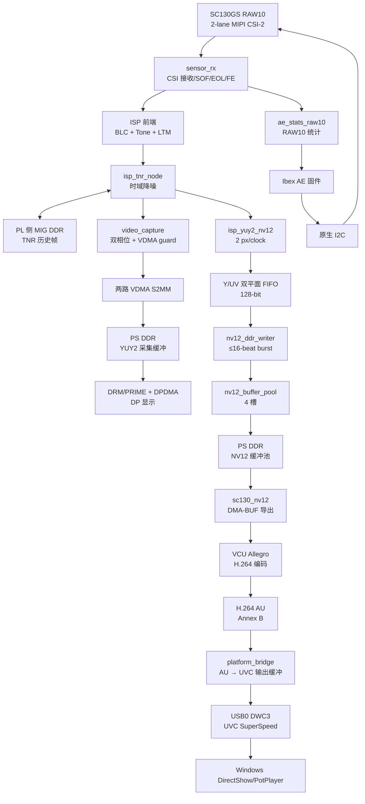

# ZU4EV 摄像头采集 → ISP → DP / USB3.0 H.264 显示系统工程研发报告

**报告日期**：2026-11-06  
**工程目录**：`E:\workspace\AI_Projects\RISC_V\ibex`  
**代码基线**：分支 `codex/zu4ev-h264-uvc`，HEAD `6bf61d54`  
**目标硬件**：MiniZU XCZU4EV-SFVC784-2-I，SC130GS 1280×1024@120 fps  
**软件基线**：Linux 6.12，Vivado/Vitis 2025.1，RV32IMC 原生 AE 固件  
**核心链路**：MIPI CSI-2 RAW10 → PL ISP/LTM/TNR → YUY2 双路采集 → DP 显示；最终 ISP 输出 → PL NV12 → DMA-BUF → VCU H.264 → UVC/USB3.0 → Windows

> 证据边界：本报告基于当前源码、架构文档和既有板级验证记录整理；本次没有重新运行硬件测试，文中“实测”均指既有记录中的结果。

---

## 0. 结论摘要

这是一个典型的 **异构视频系统**，不是“单颗 SoC + 软件 ISP”的方案：

- **PL（可编程逻辑）** 承担高吞吐、强实时的像素流水线：CSI 接收、黑电平/色调映射、局部色调映射 LTM、时域降噪 TNR、YUY2 打包、双相位采集、NV12 转换与 DDR 写出。
- **PL 内的 Ibex（RV32IMC）** 承担自动曝光 AE 控制：读取 RAW10 统计与帧事件，通过原生 I2C 调整传感器曝光/增益，不搬运整帧图像。
- **PS 内的 A53（Linux）** 承担系统管理：V4L2 采集、DMA-BUF 管理、DRM/DP 显示、VCU 编码队列、UVC gadget 与 USB 输出。
- **VCU 硬核** 承担 H.264 压缩，避免 A53 做软件编码。

系统已经跑通并记录了以下关键结果：

| 指标 | 结果 |
|---|---|
| 分辨率/帧率 | 1280×1024@120 fps |
| DP 路径 | YUY2 采集帧经 DRM/PRIME 导入，DPDMA 扫描输出 |
| USB 路径 | PL NV12 → DMA-BUF → VCU H.264 → UVC，Windows DirectShow/PotPlayer 可识别 |
| NV12 路径 A53 CPU 占用 | 约 32.4%～34.3%（单核），旧 NEON 转换基线约 75.3% |
| 初步释放算力 | 约 41～43 个百分点单核算力，约 56.9% 的实测 CPU 工作降幅 |
| NV12 外设资源 | 约 2217 LUT、1470 FF、4 BRAM，无 DSP/URAM |
| NV12 布局布线 | WNS +0.033 ns、WHS +0.010 ns、TNS/THS=0、DRC 0 错误 |
| H.264 长测 | 72,000 帧/599.31 s、36,000 帧/299.11 s，约 20 Mbps，记录区间 USB 错误为 0 |
| NV12 板测 | 主机两轮解码 4022/4015 帧，稳定窗口约 120 fps |

但必须明确边界：**这不是端到端零拷贝**。NV12 原始帧通过 DMA-BUF 在 PL、Linux、VCU 之间共享，但 VCU 产生的 H.264 AU 到 UVC 输出缓冲仍有用户态复制；A53 仍负责队列、IRQ、DRM 翻页、AU 复制和 USB 提交。USB DWC3 的偶发 `ERROR buffer` 根因也尚未闭环。

---

## 1. 系统总体架构

### 1.1 硬件与执行主体

| 执行主体 | 主要职责 | 输入/输出 |
|---|---|---|
| SC130GS 传感器 | 曝光并输出 RAW10 | I2C 配置；2-lane MIPI CSI-2 |
| PL `sensor_rx` | CSI 控制、接收、PHY 故障同步 | RAW10 像素、SOF/EOL/FE、packet error |
| PL ISP | 黑电平、全局 Tone、LTM、TNR、YUY2 打包 | RAW10 → YUY2 |
| PL `video_capture` | 双相位帧选择、FIFO、VDMA 写完成保护 | YUY2 → PS DDR |
| PL NV12 外设 | YUY2→NV12、双平面 FIFO、DDR 写出、四槽池 | 最终 YUY2 → PS DDR NV12 |
| PL Ibex | RAW 统计、AE 计算、传感器 I2C | 统计/FE/SOF → 曝光/增益 |
| A53 Linux | V4L2、DMA-BUF、DRM/DP、VCU、UVC | 帧描述符、码流、USB |
| VCU | H.264 硬件压缩 | NV12 → H.264 AU |
| PS DPDMA/DP | 从 DDR 读 YUY2 并显示 | YUY2 → DisplayPort |
| PS USB0 DWC3 | UVC 视频传输 | H.264 AU → Windows |

### 1.2 三个平面

- **数据平面**：像素、NV12、H.264 码流、USB 载荷。
- **控制平面**：ISP/TNR 寄存器、传感器 I2C、VCU V4L2 controls、UVC 描述符/请求。
- **观测平面**：帧序号、FE/SOF、统计快照、错误计数、性能直方图、AE mailbox。

把这三类流量分开理解，是读懂工程的关键。例如 Ibex 只读“统计与事件”，不接收整帧；DP 只读 YUY2 采集帧，不解 H.264；USB 只消费编码后的 AU。

### 1.3 顶层模块地图

生产综合入口是 `platform/zu4ev/rtl/camera_top.v`：

```text
camera_top
├─ platform                 # 参考时钟、复位、TNR 存储、MIG/CDC
├─ soc_subsystem            # PS block design、I2C 开漏引脚路由
├─ sensor_rx                # CSI 控制、CSI RX、PHY fault 同步
├─ isp                      # PIPELINE=1 / USE_LTM=1 / USE_TNR=1 / ISP_RUNTIME=1
│  ├─ isp_capture_frontend  # RAW AE 统计分支 + 图像处理分支
│  ├─ ltm_processor         # 5×5 双边分层 LTM
│  └─ isp_tnr_node          # 时域降噪
├─ video_capture            # 双相位采集 + VDMA + write guard
├─ nv12_capture_peripheral  # YUY2→NV12 + DDR writer + 4-slot pool + AXI-Lite/IRQ
└─ debug_monitor            # GPIO snapshot、同步器、诊断、ILA
```

`sc130_camera_top_v2.v` 是转发兼容封装，真正的生产入口是 `camera_top`。

---

## 2. 原理阐述

### 2.1 传感器与 MIPI CSI-2 RAW10

SC130GS 在曝光完成后持续输出 RAW10 像素。当前配置为 1280×1024、约 120 fps、2 条 MIPI 数据 lane。进入 PL 的并行接口每个有效拍包含两个 10 bit 像素，低 20 bit 分别承载两个像素，不能把它理解成已经排好的 RGB 或 YUV。

`sensor_rx` 封装 CSI 控制、接收 IP 和 PHY 故障同步：

- **SOF**：帧开始；
- **EOL**：行结束；
- **FE**：帧结束事件；
- **packet error / global fault**：打包错误与全局故障。

像素、valid、SOF、EOL、packet error、global fault 必须保持对应关系。发生错误时，仅有“像素数量正确”不足以证明整帧可信。

传感器是**持续输出源**，不能像普通软件队列一样随时暂停。下游 FIFO 只吸收短暂停顿；长期处理不及时会造成溢出或丢帧。设计中的 READY 信号不意味着能够把背压一路传回传感器，这是理解后面 NV12 “不可暂停输入”契约的前提。

### 2.2 ISP 处理链

生产顶层明确选择：

```verilog
isp #(
    .PIPELINE(1),
    .USE_LTM(1),
    .USE_TNR(1),
    .ISP_RUNTIME(1)
) isp (...)
```

这些参数表示对应硬件已经综合进设计；运行时是否启用某项处理，还由活动配置决定。

#### 2.2.1 RAW10 统计分支

`isp_capture_frontend.sv` 从原始输入分出 `ae_stats_raw10` 统计路径，同时送入图像处理路径。AE 统计因此不是从 H.264 解码画面或 DP 截图反推，而是在 **RAW10 域**累加、计数并产生均值、帧号和统计序号。ROI、黑电平和使能状态也随统计结果记录。

这是一个重要设计优点：AE 看到的是传感器原始曝光结果，而不是经过 Tone/LTM/TNR 后的显示亮度。后者已经被非线性映射和降噪改变，用它做 AE 会引入环路耦合。

#### 2.2.2 黑电平与全局 Tone

全局 Tone 路径对每个像素进行黑电平校正与查表映射。历史标定使用 RAW10 黑电平 52，但它与曝光、增益、温度有关。固定 ROM 分支把“减黑电平 + 非线性映射”折叠成查表；运行时 LTM 路径有自己的配置和曲线存储，不能把所有分支都理解为同一个固定 ROM。

#### 2.2.3 LTM 局部色调映射

LTM 先用 **5×5 双边滤波** 分离基础层 B 和细节层 D，满足：

```text
I = B + D
```

其中：

```text
S = outer([1,4,6,4,1], [1,4,6,4,1])
R(d) = floor(255 * exp(-d*d/(2*64*64)) + 0.5)
w(q) = S(q) * R(|I(q) - I(center)|)
B = floor((sum(w*I) + floor(sum(w)/2)) / sum(w))
D = I(center) - B
```

双边滤波同时考虑空间距离与灰度差，因此比普通均值滤波更能保留边缘。基础层经过 Tone 曲线，再与缩放后的细节重建。`gain/256` 是细节系数，例如 96 对应 0.375。

实现细节：

- 5 组行缓存，20 bit×1024 深度；
- 5×5 窗口，四边复制边界；
- 每行末自动补一个双像素拍，帧末补两行，保证最后两行可输出；
- 13 级算术流水；
- 2 像素/拍吞吐；
- 固定 `sigma_s≈1`、`sigma_r=64`（RAW10 码值）；
- 分母最大 65280，26 位分子含舍入后最大 66814080，无溢出；
- B 为 10 位，D 为 11 位二补码。

LTM 改变亮度映射后，必须清 TNR 历史，避免把不同映射下的亮度混合。

#### 2.2.4 YUY2 打包

处理后的亮度以 YUY2 打包：两个像素对应四个字节：

```text
Y0 U Y1 V
```

本工程灰度通路使用 `U=V=128`。YUY2 是承载格式，采用 YUV 格式并不表示 ISP 已生成彩色图像。当前配置本质上是单色/灰度画面。

### 2.3 TNR 时域降噪

`isp.v` 中的 `isp_tnr_node` 位于前端之后。它根据当前帧和历史帧的差异选择融合强度：

- 静止区域更适合融合，降低随机噪声；
- 运动区域减弱融合，避免拖影；
- `alpha`、`motion-low/high` 是运行时控制量。

历史帧需要帧级存储，通过 `tnr_memory_bridge.sv` 和 `platform` 内的 MIG 路径读写。关键边界：

- 复位默认旁路；
- 内存校准成功不等于 TNR 已启用；
- 清历史后第一帧先建立历史；
- 改变上游 Tone、LTM 模式或曲线后，应清历史；
- TNR 能压低帧间随机噪声，但固定在同一像素上的偏差可能留在历史中；
- 暗部曲线和曝光增益也会放大噪声。

### 2.4 AE 闭环与 Ibex 主控

#### 2.4.1 Ibex 小系统

Ibex 是综合在 PL 中的 RV32IMC 处理器，与 ARM A53 是两套 CPU。当前原生固件的任务是 ISP/AE 控制，像素处理由周围专用 RTL 完成。

| 模块 | 职责 |
|---|---|
| `ibex_small_core.sv` | 包装 small 配置 Ibex 内核，保留 RegFileFF |
| `ibex_small_system.sv` | 内核、存储、地址译码、中断、可选外设 |
| `ibex_small_mem.sv` | 程序区、数据 RAM、双口观测、引导复制 |
| `ibex_native_to_axi_lite.sv` | 原生 MMIO → AXI-Lite |
| `ibex_isp_cfg_cdc.sv` | 跨控制时钟域传递 ISP 配置事务 |
| `ibex_isp_snapshot.sv` | 跨视频域的一致统计和帧事件 |
| `ibex_isp_cfg_owner.sv` | PS/Ibex 对 ISP 与传感器的所有权仲裁 |
| `ibex_sensor_ctrl.sv` | 传感器控制状态、授权、停止、超时 |
| `ibex_sensor_i2c.sv` | I2C 时序、寄存器读写、开漏驱动 |

存储布局：

```text
程序：0x00100000..0x0013ffff  256 KiB（板版 UltraRAM）
数据：0x00200000..0x0023ffff  256 KiB（板版 UltraRAM）
入口：程序基址 + 0x80
mailbox：0x0023e000
```

UltraRAM 不能像初始化 ROM 那样随配置直接提供全部程序内容，因此小型 BRAM 引导内容在释放 CPU 前复制到程序 UltraRAM，并补零。完整复制需要 131072 个时钟，在 100 MHz 下约 1.31 ms。这只是存储准备时间，不是整机启动时间。

#### 2.4.2 统计跨域

图像统计发生在视频时钟域，Ibex 主要工作在 100 MHz lite 域。一个多位统计总线若逐 bit 用双触发器同步，可能拼出来自不同帧的混合值。`ibex_isp_snapshot.sv` 使用握手使读者取得一致的一组数据；FE/SOF 序号用于确认统计对应的时间和更新边界。

帧事件进入 Ibex 中断路径，固件再读统计、检查序号和状态。中断不是“传递整幅图像”，只是在告诉控制程序某个事件发生了。

#### 2.4.3 AE 策略

固件启动先验证：

- 历史板级 ID `0130`；
- stream-on；
- VTS、曝光、增益；
- AE 控制使能与读回。

策略保留：

- 目标 `target=96`；
- 死区 `deadband=8`；
- 有限步长：单次更新限制在当前值的 `3/4..5/4`；
- 四个 FE 的 holdoff；
- 暗场优先增加曝光，曝光到顶后增加增益；
- 亮场存在额外增益时先减增益；
- 细增益 `0x20..0x3f`；
- 最大曝光 `(VTS-4)*16`，曝光按 16 对齐；
- 写后读回确认；
- 出错进入 fail-stop 并记录 fault。

`target96` 的含义应结合 AE 算法内部归一化理解，不能直接当成播放器中的 8 bit Y=96。

#### 2.4.4 I2C 与所有权交接

上电时 PS/FSBL 负责传感器和基础平台初始化。之后 Linux 的 `ibex_isp_handoff` 把控制权交给 Ibex。R5 AE 和其他 PS I2C/ISP 写入者必须停止，防止两套控制器同时改同一设备。

交接工具检查：

- IIC0 时钟与复位状态；
- 控制器空闲；
- FIFO 状态；
- ISP 标识与待提交状态；
- 固件 boot-ready；
- 新鲜的 quiescent 应答；
- PS 已释放 SCL/SDA，且两线连续高电平至少 5 μs。

I2C 使用开漏方式：控制器只能拉低或释放，不能推挽强驱高。

```sh
./ibex_isp_handoff status
./ibex_isp_handoff start --ps-writers-stopped
./ibex_isp_handoff stop
```

停止时 RUN=0，请求带 stop toggle/ack；固件完成当前字节组及读回后确认静止，随后才能回收控制权。超时退出而不强抢总线。

### 2.5 双相位采集与 VDMA

`video_capture.v` 为两个通道共用一组 source sequence 和 source tick：

- 通道 0 选择偶数源帧；
- 通道 1 选择奇数源帧。

这里的“双核采集”是两套采集硬件，不是两个 A53 CPU 核，也不是两台摄像机。交替处理使一路在本帧完成与重新准备时，另一路有机会接收下一帧。

每个通道都有：

- 帧选择；
- arm/ack/epoch 握手；
- FIFO；
- 尺寸和错误检查；
- VDMA 写完成保护。

`vdma_write_guard_v2.v` 在面向 DDR 的 AXI 写接口观察地址、数据和写响应。它核对实际写入字节数以及事务退休状态。**像素流已经到帧尾，并不意味着 DDR 写响应已经返回**；在这个时间点过早交给显示器或 USB，就可能读到未写完的帧。

Linux 的 `sc130_capture` 驱动把两路硬件组织成逻辑采集设备，处理顺序、代际、停止状态和 V4L2 缓冲完成。用户态用 DQBUF 取得完成帧，用 QBUF 归还可再用缓冲。

### 2.6 DP 显示

桥接程序通过 DMA-BUF 导出或共享采集缓冲，DP 使用 DRM/PRIME 导入，DPDMA 从 PS DDR 读取。应用提交新画面后，必须等待显示系统确认旧帧退役，才可释放旧帧的占用。

关键点：

- DP 使用原始 YUY2 采集帧，不经过 H.264 压缩与解码；
- 显示输出频率、扫描时序和摄像头帧率是不同概念；
- 不能仅凭“采集 120 fps”就推导显示器的实际刷新模式；
- 旧帧只有在 page-flip 完成后才能释放。

### 2.7 PL NV12 输出与 VCU 编码

NV12 版本以 `SC130_NV12` 编译宏启用。`camera_top.v` 中 `nv12_capture_peripheral` 直接接入最终 ISP/TNR 输出 `converted/cv/cs/ce`，错误输入为 `packet_d | fault_d`，因此编码画面包含最终处理结果。显示分支仍走原 YUY2 采集与 VDMA。

顶层采用独立外设，不应再同时启用 `isp.v` 内的可选 NV12 转换器，避免重复实例。

#### 2.7.1 YUY2→NV12 转换

`isp_yuy2_nv12.v` 每拍处理 `Y0 U Y1 V` 两个像素：

- 将 Y 分离；
- 相邻两行的 U/V 按 `(上一行 + 当前行 + 1) >> 1` 舍入平均；
- 输出 4:2:0 交织 UV；
- 转换器保存一行色度，不需要整帧像素缓存；
- 持续输入无法暂停，溢出或异常帧必须丢弃并在后续 SOF 恢复。

转换器状态：

- `idle/active`；
- SOF 开始一帧；
- 几何异常、输入 fault、必需输出槽被占用 → abort；
- `frame_abort` 使整个目标缓冲失效，包括已传输像素；
- 待输出数据在暂停期间保持稳定；
- 只有后续 SOF 且有空槽才允许重启；
- `frame_done` 表示最终输出握手完成，**不是 DDR 写响应完成**。

#### 2.7.2 双平面 FIFO 与 DDR Writer

Y、UV 各自经过打包 FIFO，形成 128 bit AXI 写数据：

- 每拍接受一个 16 bit pair；
- 行尾冲刷部分 beat；
- FIFO 默认 256 beat（4096 字节/平面）；
- 寄存器同步读端口 + 一个 head 寄存器，稳定 ready/valid；
- 无 CDC。

`nv12_ddr_writer.v` 将两个平面写入同一槽位：

```text
Y  : base
UV : base + stride × height
```

当前 1280×1024、stride=1280：

```text
Y  = 1,310,720 字节
UV =   655,360 字节
合计 = 1,966,080 字节/帧
```

突发最多 16 拍，不跨行或 4 KiB 边界。完整帧只有在全部 AXI B 写响应退休后才能发布。发生写错误时先排空已接受的事务，再报告失败。没有超时可以伪造成功完成。

AXI 细节：

- 128 bit 数据；
- 32 bit 字节地址；
- 单 ID；
- descriptor base/stride 16 字节对齐；
- `stride >= WIDTH`；
- 单 burst outstanding；
- AW/W/B 独立退休；
- BREADY 在 AW 和全部 W 退休后拉高；
- 最终结果要求两平面计数耗尽、FIFO 空、无 outstanding write。

#### 2.7.3 四槽缓冲池

`nv12_buffer_pool.v` 管理四个独占槽位及完成 FIFO：

```text
FREE → RESERVED → WRITING → READY → HELD → FREE
```

- 配置只允许在未使用/空闲槽位；
- 配置范围不得重叠；
- 分配使用 round-robin；
- READY 交付使用 4 项完成 FIFO，保持 writer 完成顺序，即使槽位索引回绕；
- 没有空闲槽时丢弃新源帧，不能覆盖 VCU 正在读取的槽位；
- 失败帧在 writer 排空 B 响应后回收；
- consumer 用 tag 归还槽位。

#### 2.7.4 AXI-Lite 寄存器契约

NV12 外设基址 `0xA0080000`，64 KiB，ABI v2：

| 偏移 | 访问 | 含义 |
|---|---|---|
| `0x00` | RO | ID `0x4e563132` |
| `0x04` | RO | version 2 |
| `0x08` | RW | bit0 帧 IRQ 使能；bit1 capture ENABLE（复位 0） |
| `0x0c` | RO | bit0 完成帧 pending；bit1 pool 配置就绪；bit2 DMA IDLE |
| `0x10` | RW | 配置槽位 0..3 |
| `0x14` | RW | DMA base（32 位） |
| `0x18` | RW | stride |
| `0x1c` | RW | consumer release tag |
| `0x20` | WO | 命令：1 配置槽位；2 take 完成帧；4 release；8 STOP |
| `0x24` | RO | pending frame base |
| `0x28` | RO | pending frame stride |
| `0x2c` | RO | pending frame slot tag |
| `0x30` | RO | 无缓冲丢帧计数 |
| `0x34` | RO | 写失败/帧失败计数 |

读取顺序：先读 STATUS，再读 pending metadata，最后 TAKE。metadata 在 TAKE 前保持稳定。TAKE 把所有权交给软件，撤销该帧 level IRQ，但**不释放槽位**；RELEASE 只能在 VCU 输入 DQBUF 之后执行。

中断接 `pl_ps_irq1[0]`，GIC INTID=136，设备树使用 SPI 104（`<0 104 4>`）。

#### 2.7.5 安全停止

停止序列：

1. 写 `COMMAND=8`，或清 `CONTROL.ENABLE`；
2. 轮询 `STATUS` bit2，直到 IDLE=1；
3. STOP 的 B 响应只表示“命令被接受”，不表示 AXI 已排空；
4. IDLE=1 才表示 PL 不再发起新的内存访问；
5. IDLE 不表示 VCU 已释放先前提交的缓冲；
6. 保留 DMA 映射，重启必须等 IDLE 后的后续 SOF；
7. 释放完整映射前，必须同时获得 PL IDLE 和 VCU 完成，再做协调复位；
8. 不允许用超时强制释放仍可能被 DMA 访问的内存。

#### 2.7.6 Linux 驱动与 VCU 导入

`sc130_nv12.c`：

- 分配四块持久 coherent DMA 内存；
- 总计约 7.5 MiB；
- 通过 `/dev/sc130-nv12` 导出 DMA-BUF；
- 完成 IRQ；
- 维护槽位所有权；
- 提供 GETBUF/START/STOP/DQBUF/QBUF 用户态 ABI。

VCU 以 `V4L2_MEMORY_DMABUF` 导入相同内存。应用不再映射、复制或转换原始编码输入像素，但仍管理队列和压缩码流。

一帧的交接顺序：

```text
硬件 B 响应全部完成
→ IRQ / 驱动 TAKE
→ 应用 SC130_NV12_DQBUF
→ VCU 输入 QBUF
→ VCU 输入 DQBUF
→ SC130_NV12_QBUF 归还槽位
```

压缩 AU 已产生，不等于 VCU 输入槽已经释放。V4L2 编码器的 OUTPUT 队列接收原始输入，CAPTURE 队列返回压缩输出。

### 2.8 VCU H.264 编码

编码仍为 H.264，支持 60/120 fps：

- 默认目标码率 20 Mbps；
- Baseline / Level 5.1；
- 本次改动没有切换到 H.265；
- VCU 控制基址 `0xA1000000`，中断 SPI96。

`h264_encoder.c` 的关键职责：

- Allegro V4L2 设备枚举；
- NV12 DMA-BUF 导入与归还；
- 编码 AU 处理；
- 保留旧 NEON `encoder_convert()` 兼容路径。

新路径关键函数：

```text
h264_encoder_pump_nv12()
h264_encoder_submit()
h264_encoder_release()
h264_encoder_next()
```

旧路径：

```text
encoder_convert()   // A53 NEON YUY2→NV12
```

启动参数：

```text
--nv12 /dev/sc130-nv12
```

未指定该选项时，旧 NEON 路径仍可供匹配平台使用，但本次 NV12 启动配置不会自动回退到 CPU 转换。

### 2.9 UVC 与 USB3.0

`platform_bridge.c` 将编码 AU 复制到 UVC 输出缓冲，使用真实的 `bytesused` 提交。USB gadget 以 frame-based H.264 描述符枚举，Windows 将其识别为摄像头；PotPlayer 通过采集接口接收并解码。

关键点：

- 不能用 YUY2 描述符传送 H.264 内容；
- 发送层的 8192 字节载荷设置是 USB 请求覆盖与调度参数，不是 H.264 帧尺寸；
- 一个 AU 可以由多个 USB 载荷传输；
- 帧序、时间戳与 UVC 边界必须一起保持正确；
- 新会话需要 SPS/PPS/IDR；
- SPS/PPS 描述解码参数，IDR 提供独立恢复起点；
- 当前恢复逻辑在计数到 USB ERROR 后丢弃后续预测 AU，等待验证通过的 SPS/PPS/IDR 再恢复发送；
- 错误仍然计数，这种机制修复播放连续性，不代表已找出 DWC3 偶发错误根因；
- USB 停止或断开启闭相应编码会话，YUY2 采集与 DP 独立继续。

---

## 3. 工程目录结构

### 3.1 仓库分层

```text
ibex/
├─ README.md                         # 项目总览 + 完整研发报告
├─ rtl/ vendor/ dv/ formal/ lint/ syn/   # 上游 Ibex CPU RTL 与验证基础设施
├─ integration/small/                # 本次 Ibex 主控集成源
├─ platform/zu4ev/                   # ZU4EV 相机/ISP/驱动/板级源快照
├─ docs/                             # 架构、实现、验证、报告
├─ build/                            # 本地构建产物、时序报告、板测证据
└─ ci/ util/ examples/ tests/ ...    # 上游工具与辅助配置
```

### 3.2 `platform/zu4ev` 目录

```text
platform/zu4ev/
├─ rtl/
│  ├─ camera_top.v                   # 生产综合入口
│  ├─ sensor/sensor_rx.v             # CSI 控制、CSI RX、PHY fault
│  ├─ capture/video_capture.v        # 双相位采集 + VDMA
│  ├─ capture/vdma_write_guard_v2.v  # AXI 写响应退休检查
│  ├─ platform/                      # 时钟、复位、TNR MIG、CDC
│  ├─ soc/soc_subsystem.v            # PS block design + I2C 开漏路由
│  └─ debug/debug_monitor.v          # GPIO snapshot、同步器、诊断、ILA
├─ isp/
│  ├─ isp.v                          # PIPELINE/LTM/TNR/RUNTIME 顶层
│  ├─ isp_capture_frontend.sv        # 统计分支 + 图像分支
│  ├─ raw10_to_yuy2.v                # 兼容 BYPASS 路径
│  ├─ sc130_tonemap_yuy2.v           # 全局 Tone 路径
│  ├─ ae/ae_stats_raw10.sv           # RAW10 AE 统计
│  ├─ ltm/                           # 5×5 双边分层 LTM + AXI 寄存器
│  ├─ tnr/                           # isp_tnr_node/tnr_core/tnr_axi_regs
│  └─ nv12/                          # converter/FIFO/writer/pool/AXI regs
├─ software/
│  ├─ platform_bridge.c              # 主事件循环
│  ├─ capture_broker.h               # 采集缓冲持有/释放规则
│  ├─ dual_core.h                    # 双采集通道顺序与状态契约
│  ├─ dp_display.c                   # DRM/DP 显示
│  ├─ h264_encoder.c                 # Allegro VCU 编码
│  ├─ uvc_core.c/.h                  # UVC 状态机
│  ├─ nv12_capture.h                 # NV12 用户态 ABI
│  ├─ nv12_vcu_probe.c               # VCU 输入布局探测
│  ├─ perf_stats.h                   # CPU/延迟统计
│  ├─ ibex_isp_handoff.c             # PS/Ibex 控制权交接
│  ├─ isp-control/ispctl.c           # ISP 寄存器/曲线/统计工具
│  ├─ tnr-control/tnrctl.c           # TNR 配置/清历史/内存测试
│  ├─ ibex-ae/                       # 原生 AE 固件副本
│  └─ tests/                         # 软件回归
├─ linux/
│  ├─ kernel/sc130_capture.c         # 双相位采集 V4L2 驱动
│  ├─ kernel/sc130_nv12.c            # 四槽 DMA-BUF 驱动
│  ├─ kernel/sc130_raw_capture.c     # RAW 调试采集
│  ├─ kernel/sc130_contract.h        # 内核/用户态契约
│  ├─ dt/sc130-nv12.dts              # NV12 寄存器与中断描述
│  ├─ patches/0001..0012             # UVC/VDMA/DP/Allegro 补丁
│  ├─ setup_uvc.sh                   # ConfigFS H.264 UVC gadget
│  ├─ start-platform.sh              # CPU0-only + 启动次序
│  ├─ build_h264_kernel.sh           # 内核构建
│  ├─ build_nv12_runtime.sh          # NV12 运行时构建
│  └─ VCU_PREREQUISITES.md           # VCU 驱动/固件前提
├─ hardware/
│  ├─ ps_system.tcl                  # PS block design + 地址映射
│  ├─ add_vcu.tcl                    # VCU 连接
│  ├─ add_nv12.tcl                   # NV12 AXI/DDR/中断接线
│  ├─ camera_clocks.tcl              # 时钟配置
│  ├─ camera_ila.tcl / uvc_ila.tcl   # ILA
│  └─ pl_ddr4.tcl                    # PL DDR4
├─ constraints/
│  ├─ board.xdc                      # 板级引脚/时序
│  └─ pl_ddr4.xdc                    # DDR4 约束
├─ boot/                             # FSBL/QSPI 打包
├─ firmware/boot_reference/          # FSBL BSP 参考
├─ docs/                             # 平台文档
├─ tools/                            # 工程生成/监控/时序检查
├─ README.md                         # 平台快照说明
├─ H264_VALIDATION.md                # H.264 离线验证记录
├─ BOARD_VALIDATION_20261102.md      # 板级验证记录
├─ IBEX_ISP_MASTER.md                # Ibex 主控/交接契约
└─ source_manifest.json              # 297 个导入文件哈希清单
```

### 3.3 `integration/small` 目录

```text
integration/small/
├─ rtl/
│  ├─ ibex_small_core.sv             # small 配置 Ibex 包装
│  ├─ ibex_small_system.sv           # CPU/存储/地址译码/中断
│  ├─ ibex_small_mem.sv              # 程序/数据存储、URAM 引导复制
│  ├─ ibex_small_loader.sv           # 可选 PS 固件装载（当前关闭）
│  ├─ ibex_isp_snapshot.sv           # video→lite 一致统计快照
│  ├─ ibex_isp_cfg_cdc.sv            # lite↔video 配置 CDC
│  ├─ ibex_native_to_axi_lite.sv     # native→AXI-Lite 主机
│  ├─ ibex_isp_cfg_owner.sv          # PS/Ibex 所有权仲裁
│  ├─ ibex_sensor_ctrl.sv            # 传感器生命周期
│  └─ ibex_sensor_i2c.sv             # 原生 I2C
├─ ae_live/
│  ├─ ae_core.c/.h                   # AE 策略（可宿主机测试）
│  ├─ ibex/main.c                    # 上板 AE 主循环
│  ├─ ibex/runtime.c                 # freestanding memcpy/memset
│  ├─ ibex/start.S                   # 启动/中断向量
│  ├─ ibex/link.ld                   # ROM/RAM/栈布局
│  ├─ ibex/board.h                   # MMIO/mailbox/日志结构
│  └─ host/                          # AE 算法/循环/port 测试
├─ board/
│  ├─ ibex_board_debug.sv            # 板级 Ibex 实例
│  ├─ prepare_ae_copy.py             # 隔离平台快照生成
│  ├─ build_ae_board.tcl             # Vivado 构建
│  ├─ isp_snapshot_cdc.tcl           # 统计 CDC 约束
│  ├─ isp_config_cdc.tcl             # 配置 CDC 约束
│  └─ report_*.tcl                   # 资源/时序/检查报告
├─ boot/                             # FSBL 重建、QSPI 打包、启动测试
├─ sim/                              # CPU/存储/ISP/I2C/AE 端到端 TB
├─ opentitan/                        # 可选外设，当前生产关闭
├─ DESIGN.md                         # 小系统设计
├─ RESULTS.md                        # 验证结果
└─ sources.txt                       # 有序源清单
```

### 3.4 三种“源”的区别

这是维护时最容易混淆的地方：

1. **上游 Ibex CPU 源**：`rtl/`、`vendor/`，通过 `ibex_small_core` 封装使用，没有把 CPU 改成 ISP 专用核。
2. **本次 Ibex 集成源**：`integration/small/`，是可维护的集成、固件、测试、打包入口。
3. **冻结平台快照**：`platform/zu4ev/`，是原 ZU4EV 相机平台的版本化源，包含经过 patch 的真实顶层、ISP 端口、所有权和传感器引脚连接。修改平台必须通过拷贝/patch 流程重新生成并校验清单，不能只改临时 Vivado 生成文件。

---

## 4. 视频数据 Pipeline

### 4.1 全链路图



关键分叉点：**最终 TNR 输出之后，显示走 YUY2 采集池，编码走 NV12 四槽池，二者不共享同一张内存帧**。

### 4.2 逐级追踪表

| 阶段 | 主要模块 | 数据形态/宽度 | 时钟域 | 关键动作/边界 |
|---|---|---|---|---|
| 0 传感器 | SC130GS | RAW10，2 lane | 传感器时钟 | 持续输出，无背压 |
| 1 CSI 接收 | `sensor_rx` | 2×10 bit/拍 | 视频域 | SOF/EOL/FE、packet error、global fault |
| 2 统计分支 | `ae_stats_raw10` | 均值/计数/和/ROI | 视频域 | 与图像分支同源，RAW10 域 |
| 3 前端处理 | `isp_capture_frontend` | RAW10 → 处理中 | 视频域 | BLC、Tone、LTM |
| 4 LTM | `ltm_processor` | 10 bit base/detail | 视频域 | 5×5 双边、5 行缓存、2 px/clk |
| 5 TNR | `isp_tnr_node` | YUY2 | 视频域 + MIG 用户时钟 | 历史帧在 PL 侧 DDR |
| 6 YUY2 打包 | `isp` 输出 | 32 bit `Y0 U Y1 V` | 视频域 | U=V=128，灰度 |
| 7 采集 | `video_capture` | YUY2 32 bit | 视频域 / VDMA | 偶奇双相位、arm/ack/epoch |
| 8 VDMA | VDMA S2MM | AXI4-Stream → DDR | PS DDR | 写 guard 检查 B 响应 |
| 9 采集驱动 | `sc130_capture` | V4L2 buffer | A53 | 顺序/代际/停止/完成 |
| 10 DP | `dp_display` | YUY2 DRM FB | A53 + DPDMA | PRIME 导入、atomic commit、page flip |
| 11 NV12 转换 | `isp_yuy2_nv12` | Y 16 bit / UV 16 bit | 200 MHz video | 2 px/clk，UV 行平均 |
| 12 平面 FIFO | `nv12_plane_fifo` | 128 bit beat | 200 MHz | 行尾冲刷、4 KiB 边界 |
| 13 DDR 写出 | `nv12_ddr_writer` | AXI4 128 bit | 200 MHz | B 响应退休后发布 |
| 14 四槽池 | `nv12_buffer_pool` | descriptor/tag | 200 MHz | FREE→…→HELD→FREE |
| 15 Linux 驱动 | `sc130_nv12` | DMA-BUF | A53 | 四块 coherent 内存 |
| 16 VCU | Allegro V4L2 | NV12 → H.264 AU | 100/200/33.333 MHz | DMABUF 输入、CAPTURE 输出 |
| 17 桥接 | `platform_bridge` | AU → UVC buffer | A53 | `bytesused`、顺序、恢复 |
| 18 UVC/USB | gadget + DWC3 | USB 载荷 | PS USB | frame-based H.264 描述符 |
| 19 主机 | DirectShow/PotPlayer | H.264 解码 | PC | 1280×1024@60/120 |

### 4.3 路径 A：DP 显示

```text
SC130GS
→ sensor_rx
→ ISP/BLC/Tone/LTM
→ TNR
→ YUY2 打包
→ video_capture（偶/奇双相位）
→ VDMA S2MM
→ PS DDR YUY2 采集缓冲
→ DMA-BUF 导出
→ DRM/PRIME 导入
→ DPDMA 扫描
→ DisplayPort
```

特点：

- DP 使用原始 YUY2 采集帧；
- 不经过 H.264 压缩与解码；
- 显示刷新率与摄像头帧率是不同概念；
- 旧帧必须等 page-flip 完成才能释放；
- 采集和 DP 在 USB 停止时仍继续运行。

### 4.4 路径 B：H.264 UVC

```text
SC130GS
→ sensor_rx
→ ISP/BLC/Tone/LTM
→ TNR
→ 最终 YUY2 tap
→ isp_yuy2_nv12
→ Y/UV 双平面 FIFO
→ nv12_ddr_writer
→ 四槽 NV12 缓冲池
→ sc130_nv12（DMA-BUF 导出）
→ VCU Allegro（DMABUF 导入）
→ H.264 AU（Annex B）
→ platform_bridge（AU 复制到 UVC 输出缓冲）
→ UVC gadget
→ USB0 DWC3 SuperSpeed
→ Windows DirectShow/PotPlayer
```

特点：

- PL 在最终 ISP/TNR 输出后生成 NV12；
- A53 不再逐像素做 YUY2→NV12；
- NV12 原始帧通过 DMA-BUF 共享给 VCU；
- AU 到 UVC 输出缓冲仍有用户态复制；
- USB 停止不影响 DP/采集；
- 失败恢复以 SPS/PPS/IDR 为锚点。

### 4.5 缓冲所有权生命周期

#### YUY2 采集帧

```text
capture QBUF
→ VDMA 写入
→ DQBUF
→ broker latest
├─ DP hold → page-flip 完成 → DP release
└─ USB hold（旧 raw 模式）→ 输出 DQBUF 完成 → USB release
→ 两侧都无 hold 且不再是 latest
→ 允许重新 capture QBUF
```

#### NV12 输入帧

```text
FREE
→ RESERVED（descriptor 提供）
→ WRITING（writer 接受）
→ READY（全部 B 响应退休）
→ HELD（driver TAKE + 应用 DQBUF）
→ VCU 输入 QBUF
→ VCU 输入 DQBUF
→ SC130_NV12_QBUF / release
→ FREE
```

关键：**VCU 还持有 NV12 输入时，PL 不能重写该槽位**。

#### H.264 AU

```text
VCU CAPTURE DQBUF
→ bridge 读取 AU
→ 复制到 UVC 输出缓冲
→ UVC output QBUF
→ DWC3 发送
→ UVC output DQBUF
→ VCU CAPTURE QBUF（归还编码器）
```

#### UVC 输出缓冲

```text
bridge QBUF
→ gadget/DWC3 排队
→ USB 传输
→ DQBUF
→ bridge 归还
```

#### TNR 历史

```text
TNR 处理
→ tnr_memory_bridge
→ MIG DDR 历史帧
→ 下一帧 TNR
```

由硬件历史帧调度决定，不经过 Linux 缓冲池。

### 4.6 时钟域与带宽

#### 时钟域

| 域 | 频率 | 主要对象 |
|---|---|---|
| lite 控制域 | 100 MHz | Ibex、PS 控制、部分 ISP/TNR 寄存器、交接 |
| video 域 | 200 MHz | ISP 像素、采集、NV12 转换、NV12 AXI-Lite、HP0 |
| TNR MIG 用户时钟 | 由 MIG 决定 | TNR 历史帧读写 |
| VCU 控制 | 100 MHz | VCU AXI-Lite |
| VCU 编码/内存 | 200 MHz | 编码器与内存接口 |
| VCU 参考 | 33.333333 MHz | VCU 参考时钟 |

新增 NV12 外设、HPM0/control 相关端口、memory interconnect 与 HP0 端点实际均使用 200 MHz video 时钟；新增路径不另加 AXI CDC。已有 VCU 100 MHz 控制时钟保持不变。不同域的精确网络应以当前硬件 Tcl 与时钟报告为准，不能把所有控制口都假设成同一个时钟。

#### 带宽

1280×1024@120 fps：

```text
像素率 = 1280 × 1024 × 120 = 157,286,400 px/s
```

| 数据形态 | 每帧字节 | 120 fps 带宽 |
|---|---:|---:|
| YUY2 | 2,621,440 | 314.6 MB/s |
| NV12 | 1,966,080 | 235.9 MB/s |
| 旧 NEON 转换逻辑源读+目标写 | — | 约 550.5 MB/s |

新路径消除了 A53 的逐像素读写，但 PL 仍需写 NV12，VCU 仍需读 NV12，显示分支也仍写读 YUY2。**不能把 CPU 搬运减少说成整个 DDR 流量等量减少**。

NV12 转换器吞吐 2 px/clk @200 MHz = 400 Mpx/s，当前 157.3 Mpx/s 约占 39.3% 的峰值吞吐，留有抖动余量。

### 4.7 五个关键同步边界

1. **FE ≠ DDR 写完成**：FE 是帧结束事件；VDMA 的 AXI B 响应可能还没返回。
2. **原始帧释放 ≠ USB 发送完成**：DQBUF 只表示采集完成；USB 还要经过 VCU、AU 复制、UVC 队列和 DWC3。
3. **NV12 `frame_done` ≠ DDR 写完成**：必须等全部 B 响应退休才能发布。
4. **NV12 槽位复用 ≠ 帧发布完成**：必须等 VCU 输入 DQBUF 后才能归还槽位。
5. **STOP ack ≠ IDLE**：STOP 只表示命令接受；IDLE 才表示 PL 已排空；IDLE 又不表示 VCU 已释放缓冲。

这五个边界是理解整个工程的核心。能独立解释它们，基本就不会把两条输出路径和四套缓冲池混在一起。

---

## 5. 控制平面与安全交接

### 5.1 地址映射

| 访问者 | 基址 | 对象 |
|---|---|---|
| A53 PS | `0xA0000000` | VDMA 0 |
| A53 PS | `0xA0010000` | Capture 0 |
| A53 PS | `0xA0020000` | VDMA 1 |
| A53 PS | `0xA0030000` | Capture 1 |
| A53 PS | `0xA0040000` | ISP |
| A53 PS | `0xA0050000` | TNR |
| A53 PS | `0xA0060000` | RAW 调试 VDMA |
| A53 PS | `0xA0070000` | RAW 调试 capture |
| A53 PS | `0xA0080000` | NV12 输出外设，64 KiB，ABI v2 |
| A53 PS | `0xA1000000` | VCU 控制 |
| Ibex | `0x50000000` | ISP 统计与事件 snapshot |
| Ibex | `0x51000000` | ISP 配置窗口 |
| Ibex | `0x52000000` | 原生传感器控制 |
| Ibex | `0x0023e000` | AE mailbox |

ISP 的 PS 窗口 `+0xff00/0xff04/0xff08` 保留所有权、停止和故障相关观测，即使 Ibex 占有 ISP 仍可读取相应状态。

### 5.2 所有权交接

| 偏移 | 作用 |
|---|---|
| `+0xff00` | owner bit0：0=PS，1=Ibex；复位默认 PS，仅 PS 可写 |
| `+0xff04` | 状态：quiescent、grant、busy、armed、fault、restart-required、boot-ready、SCL/SDA、stop-ack |
| `+0xff08` | bit0 RUN；bit1 只读回显 stop request token |

交接流程：

```text
1. PS/FSBL 初始化 sensor 和平台
2. Linux 停止所有 PS/R5 IIC0 与 ISP 配置写入者
3. ibex_isp_handoff 检查 IIC0 时钟/复位/空闲/FIFO
4. 检查 ISP identity、commit、固件 boot-ready
5. 获取新鲜 quiescence 应答
6. 检查 SCL/SDA 均释放且连续高 5 µs
7. 授予 owner=1
8. 固件进入 RUNNING，开始 AE
```

停止流程：

```text
1. RUN=0，带 stop token
2. 固件完成当前 I2C 字节组与读回
3. 固件发布 quiescent
4. 工具确认 stop-ack
5. 恢复 owner=0，PS 回收
6. 超时 2 秒则退出，不强抢总线
```

CPU-only reset 的特殊行为：

- 撤销 arm/ready；
- 已接受的 I2C 事务继续到 STOP 或 10 ms 超时；
- 完成后释放 SCL/SDA；
- 置 restart-required；
- 新会话必须重新 start，旧 RUN=1 不能自动重启 AE；
- 复位发生在两字节曝光中间时，sensor 可能留下部分值；新会话重新读取实际状态，不假定旧候选已完整应用。

---

## 6. 启动、构建与部署

### 6.1 启动链

```text
QSPI 启动映像
→ BootROM
→ FSBL 初始化 PS DDR 时钟与摄像头，并按启动项配置 PL
→ PMUFW 与 BL31 等平台固件
→ U-Boot
→ FIT 中 Linux Image + DTB + initramfs
→ /init 与 start-platform.sh
→ capture 驱动、DP、USB、VCU 与桥接应用
→ ISP/TNR 启动配置
→ Ibex 安全交接
→ Ibex AE 运行
```

FSBL、bitstream、设备树、内核、模块、VCU 固件和应用必须匹配。bitstream 决定有哪些硬件，DTB 告诉 Linux 地址和中断，驱动提供设备接口，应用组织业务。只更新 bitstream 不会自动更新 Linux 应用。

### 6.2 QSPI 布局

| 项目 | 地址/大小 |
|---|---|
| Flash | N25Q256AX1，32 MiB |
| BOOT | offset 0，必须小于 `0x00c00000` |
| FIT | offset `0x00c00000`，上限 20 MiB |
| 生产 QSPI 组合镜像 | 约 29.5 MB |
| RAM 测试 BOOT/FIT | `0x30000000` / `0x10000000` |

生产打包采用 BOOT 起始偏移 0，FIT 偏移 `0x00c00000`，NOR 容量 32 MiB。RAM-test 启动包用于临时 DDR 验证，与生产 QSPI 包有明确区别，不能相互替代。

### 6.3 NV12 验证的部署边界

NV12 上板验证使用 `build/nv12_platform/ram_candidate/BOOT.BIN` 与 `image.ub`，通过已验证的 FSBL 断点/JTAG 装载 DDR 启动：

- 保留原内核与 VCU 固件；
- 加入新 DTB、`sc130_nv12.ko` 和桥接应用；
- `/etc/sc130-nv12.conf` 设置 `SC130_USE_NV12=1` 和 `UVC_FORMAT=h264`；
- 启动脚本加载模块并传入 `--nv12`；
- **没有擦写 QSPI**；
- 不能把新 DT/驱动与缺少 `0xA0080000` 外设的旧 bitstream 配对。

这一点非常关键：当前 NV12 版本的证据是 **RAM 启动验证**，不是 QSPI 冷启动验证。

### 6.4 构建入口

```sh
# Ibex 原生 AE 固件
source /mnt/d/development/rtl/env.sh
bash integration/small/tools/build_ae_live.sh

# 生成隔离平台快照
python integration/small/board/prepare_ae_copy.py --destination <新目录>

# Vivado 2025.1
set IBEX_BOARD_COPY <新目录>
source integration/small/board/build_ae_board.tcl

# Linux 软件
make OUT=build-aarch64 CC=aarch64-linux-gnu-gcc LDFLAGS=-static all
make OUT=build-host test
```

当前工程仍依赖外部平台种子：FSBL BSP、PMUFW、BL31、U-Boot、完整 Linux 内核源、VCU 固件与工具链。它不是完全自包含的一键构建归档，这是后续工程化改进的重点之一。

---

## 7. 验证与实测结果

### 7.1 分层验证矩阵

| 层次 | 覆盖内容 | 结果与边界 |
|---|---|---|
| CPU/存储 | 真实 CPU 执行、边界、字节掩码、非法地址、ROM 写保护、URAM 启动 | 通过，不是完整 ISA 合规认证 |
| ISP snapshot/config | 真实寄存器、统计/FE/SOF、IRQ、CDC、AW/W 顺序、背压、非 owner 错误 | XSim 通过 |
| I2C leaf | 写、重复 START 读、NACK、时钟拉伸、超时、STOP | 通过 |
| 生命周期/所有权 | 5 µs idle、CPU reset drain、重新 arm、stop-token、消费者停钟 | 通过 |
| AE 端到端 | 真实 Ibex + 固件 + ISP 寄存器 + 线级 sensor 模型 | 暗增亮减、双向调整通过 |
| 故障注入 | sensor NACK、无帧 | 故障清签名并停 |
| Linux 视频软件 | broker/DP ownership/events/snapshot/marker/completion/performance/shared buffer | 13 项可执行测试通过 |
| QSPI 离线 | 归档/布局/startup/FIT 提取/hash | 通过 |
| FPGA 实现 | 综合、布局布线、bit/LTX | 通过，保留约束/方法学告警 |
| 实板 AE | sensor ID/模式、真实统计、AE、stop/start、R5 状态 | 通过 |
| USB/DP 实板 | 共享 DMA-BUF 持续流与 DP | 吞吐成立，但 USB 错误曾出现 |
| QSPI | RAM boot、写前回读、逐块/整片校验、系统复位启动 | 通过；物理断电冷启动未测 |

### 7.2 关键实测数据

| 项目 | 数据 |
|---|---|
| NV12 资源 | 2217 LUT、1470 FF、4 BRAM，无 DSP/URAM |
| NV12 时序 | WNS +0.033 ns、WHS +0.010 ns、TNS/THS=0、DRC 0 错误 |
| H.264 最终构建 | WNS 0.117 ns、WHS 0.010 ns、WPWS 0.143 ns、TNS/THS/TPWS=0 |
| 全系统 v3 资源 | LUT 49,216/87,840（56.03%）、BRAM 96.5/128（75.39%）、URAM 36/48（75%）、DSP 71/728（9.75%） |
| NV12 探测 | 2400 帧/20.18 s，约 118.9 fps |
| USB 主机解码 | 两轮 35.3 s，分别 4022、4015 帧 |
| CPU0 忙碌 | 32.449%、34.327%；旧基线 75.287% |
| 单核算力释放 | 约 41～43 个百分点；约 56.9% 实测 CPU 工作降幅 |
| H.264 长测 | 72,000 帧/599.31 s；36,000 帧/299.11 s；约 20.02 Mbps |
| 注入丢帧恢复 | 同一 DirectShow 会话 2,400 帧，后续 IDR 解码无错误 |

注意：全系统 v3 资源表和 NV12 增量资源表来自不同构建阶段，不能简单相加后当作一个新 bitstream 的最终资源承诺。

### 7.3 已知问题与证据边界

1. **USB DWC3 偶发 `ERROR buffer` 根因未闭环**  
   早期持续流出现 3 次 `USB_ERR_BUFFER`，后续累计到 65；CPU0-only 包也在约 13,320 帧后失败。8192 字节 payload 版本在 72,000 帧测试中错误为 0，但当时场景码率约 4.75 Mbps，不能证明所有场景都消除。payload 改变是调度假设，不是根因结论。

2. **单核配置是测试要求，不是 USB 错误的已证修复**  
   早期 `ramtest-final` 暴露 4 个在线 CPU，失败后改为 CPU0-only；但 CPU0 包也失败过。因此“单核”是当前验收配置，不是根因修复。

3. **NV12 只完成 RAM 启动验证**  
   QSPI 未擦写，NV12 版本没有冷启动验收；QSPI 生产镜像与 NV12 运行时 overlay 的版本对应关系必须严格核对。

4. **时序/约束仍有保留告警**  
   H.264 最终构建存在 4 输入/3 输出 missing-delay 接口检查、DSP/RAMB advisory；v3 基线存在 DRC 122 条 Warning、CDC6 6 条、CDC15 148 条、MIPI/I/O 时序方法学告警。WNS 为正不等于所有约束已签核。

5. **图像质量与真实色度未全面验收**  
   当前是灰度通路，U=V=128；没有真实色度与 A53 转换的逐字节对照，没有同场景严格 CPU A/B，没有长时间 soak。

6. **端到端延迟未完整测量**  
   现有时间戳是完成/IRQ 时间，不是源 SOF 时间；USB 队列到归还包含调度延迟，不能当作纯线缆时间。

---

## 8. 优点分析

### 8.1 架构层面

1. **职责划分清晰**  
   PL 做确定性像素流水线，Ibex 做实时 AE 控制，A53 做 Linux 系统与多媒体栈，VCU 做压缩。每类处理放在最适合的执行单元上。

2. **AE 在 RAW 域闭环**  
   统计来自 RAW10，不受 Tone/LTM/TNR 非线性影响；Ibex 独立于 Linux 调度，控制周期稳定；原生 I2C 避免 GPIO bit-bang 抖动。

3. **显示与编码解耦**  
   DP 使用 YUY2 采集帧，不依赖 H.264 编码器；USB 停止或编码会话失败时，DP 和采集继续运行。这是产品级的重要韧性设计。

4. **硬件 NV12 消除 CPU 逐像素转换**  
   实测单核 CPU 从约 75.3% 降到约 32%～34%，释放 41～43 个百分点；A53 可以留给队列、DRM、USB 和系统服务。

5. **DMA-BUF 共享减少复制**  
   NV12 原始帧在 PL、Linux、VCU 之间共享，避免 A53 映射/复制/转换；四槽池和 release tag 把“writer 完成”和“VCU 用完”分开管理。

6. **安全所有权交接**  
   PS/Ibex 双客户端、owner/RUN/stop-token、5 µs 空闲联锁、I2C 开漏、读回和 fail-stop，避免两个主控同时写 sensor/ISP。

### 8.2 数据通路层面

1. **双相位采集**  
   偶/奇两套采集硬件交替工作，一路消费时另一路接收下一帧，降低采集与消费之间的耦合。

2. **VDMA 写完成保护**  
   不把“像素流到帧尾”误当成“DDR 写完成”，避免读到未写完的帧。

3. **NV12 发布契约严格**  
   全部 B 响应退休才发布；STOP/IDLE 明确区分“命令接受”“DMA 排空”“VCU 释放”；没有超时伪造成功。

4. **NV12 转换器资源效率高**  
   只需一行色度存储，不需要整帧缓存；2 px/clk；无 DSP/URAM；约 2217 LUT 的增量成本换掉 A53 逐像素转换。

5. **UVC 标准类**  
   Windows 不需要私有驱动；frame-based H.264 描述符与真实 AU 边界配合；H.264 显著降低 USB 带宽。

### 8.3 工程与验证层面

1. **验证分层完整**  
   RTL 仿真、软件宿主机测试、内核补丁编译、设备树编译、QSPI 打包测试、RAM 上板、主机解码，各层风险分别覆盖。

2. **证据可追溯**  
   source manifest、SHA256、构建报告、板测日志、测量 JSON、解码日志；不是只给一个“能跑”的结论。

3. **失败恢复有明确锚点**  
   UVC 会话以 SPS/PPS/IDR 恢复；已排队 AU 可以先行；恢复计数与解码验证分开记录。

4. **文档边界诚实**  
   文档明确区分“编译成功”“RAM 启动成功”“QSPI 烧写成功”“冷启动成功”，没有把一种证据偷换成另一种。

---

## 9. 缺点与风险

### 9.1 高优先级

| 问题 | 影响 | 现状 |
|---|---|---|
| USB DWC3 偶发 `ERROR buffer` 根因未闭环 | 高码率/长时流可能中断，H.264 预测链断裂 | 8192 payload 是缓解候选，不是根因修复 |
| 错误恢复最多损失一个 GOP | 约 1 秒内预测帧被丢弃 | 恢复逻辑已实现并注入验证 |
| NV12 仅 RAM 启动验证 | 复位/断电后可能回到旧 QSPI 镜像 | QSPI 未更新，冷启动未验收 |
| 时序/约束未完全签核 | 小 WNS 余量、CDC/DRC 告警，PVT/工具变化风险 | NV12 WNS 仅 +0.033 ns |
| 单核 A53 余量有限 | 32%～34% 忙碌，增加功能可能挤压实时性 | 多核未验证 |

### 9.2 中优先级

| 问题 | 影响 |
|---|---|
| AU→UVC 仍有用户态复制 | 不是端到端零拷贝；CPU 和内存带宽仍有开销 |
| DDR 总流量未下降 | YUY2 显示分支 + NV12 编码分支并存，带宽和功耗增加 |
| LTM/TNR 参数固定、调优有限 | 画质在极端场景可能不是最优；固定 sigma_r 不适合所有场景 |
| 灰度通路 | 当前 U=V=128；换彩色 sensor 需要重新验证 CFA/去马赛克/白平衡 |
| 时间戳不是 SOF 时间 | 端到端延迟和帧同步分析受限 |
| 失败计数语义混合 | STOP 中止、无缓冲丢帧、AXI 写失败可能混在一起 |
| AE 日志环仅约 4.3 秒 | 120 fps 下 512 条记录覆盖时间短，现场分析需持续保存 |
| 构建不自包含 | 依赖外部 BSP、内核、VCU 固件、工具链，干净环境重建困难 |

### 9.3 低优先级但应关注

- Ibex 当前未启用 PMP/ICache 等特性；安全隔离依赖系统设计。
- sensor ID 只是板级 guard，不是厂商认证。
- 没有物理断电冷启动证据；系统复位不等于断电。
- 没有功耗/热设计数据；长时间 120 fps + DP + USB + VCU 的热稳定性未测。
- DP 与 USB 没有帧级同步/genlock；两个消费者可以独立丢帧。
- 没有 UVC 摄像头控制（曝光/亮度）通过 XU 暴露给主机。
- 没有 H.265/HEVC 支持；当前 H.264 Baseline 在同等码率下效率较低。

---

## 10. 改进建议

### 10.1 P0：可靠性与签核

1. **闭环 USB DWC3 错误根因**
   - 采集目标内核的 DWC3/xHCI trace、request status、调度时间；
   - 对比 8192 / 49152 payload、isochronous / bulk、不同 maxburst；
   - 用 USB 分析仪或主机侧 ETW 观察传输层；
   - 修复后做固定场景长测，统计错误率、恢复次数、图像完整性；
   - 验收标准：连续 1 小时以上、目标码率、DP 同时运行，USB 错误为 0 或可解释且有界。

2. **NV12 QSPI 冷启动与生产签核**
   - 构建含 NV12 bitstream、DTB、驱动、bridge 的生产包；
   - 烧写、逐块回读、整片哈希、断电冷启动；
   - 验收标准：冷启动后 `/dev/sc130-nv12` 出现、VCU 协商成功、DP + USB 同时工作、哈希匹配。

3. **时序/CDC/约束闭环**
   - 处理 DRC Warning、CDC6/CDC15、MIPI/I/O missing-delay；
   - 复核 bus-skew 逐位覆盖；
   - 给 NV12 路径增加余量（流水线、降低频率、或优化关键路径）；
   - 验收标准：目标工艺角/PVT 下 WNS 有可接受余量，所有告警有处置记录。

4. **长时 soak 与热/功耗**
   - 120 fps + DP + USB + VCU 连续运行 ≥ 数小时；
   - 记录 CPU、DDR 带宽、温度、功耗、错误计数；
   - 验收标准：无热降频、无累积错误、恢复机制可观测。

### 10.2 P1：性能与架构

1. **消除 AU→UVC 用户态复制**
   - 让 VCU CAPTURE 队列的 DMABUF 直接进入 UVC（如果内核/UVC gadget 支持）；
   - 或使用 v4l2 multiplanar + splice/零拷贝队列；
   - 减少 `memcpy` 和 syscall；
   - 验收标准：A53 CPU 再降若干百分点，AU 完整性不变。

2. **DP 与编码共享 NV12 帧**
   - 当前 DP 走 YUY2，编码走 NV12，产生两套写入/读取；
   - 如果 DP 支持 NV12/RGB，可让同一 NV12 帧同时服务 DP 和 VCU，用引用计数管理；
   - 收益：降低 DDR 带宽和 PL 写路径重复；
   - 风险：DP 色彩空间/格式支持、显示时序、所有权更复杂。

3. **NV12 池扩容与自适应水位**
   - 4 槽在 120 fps 下余量有限；可扩到 6～8 槽；
   - 增加 watermark、动态丢帧策略、槽位状态 debugfs；
   - 验收标准：VCU 短时停顿不导致 PL 无缓冲丢帧。

4. **多核/隔离与调度优化**
   - 当前 CPU0-only 是测试配置；
   - 可把 USB/VCU 队列、DP、日志分到不同核，或使用 isolcpus/RT 优先级；
   - 先做严格 A/B，再决定是否启用多核；
   - 验收标准：同场景 CPU/延迟/错误率不退化。

5. **SOF 时间戳贯通**
   - 在 sensor SOF 打时间戳，随 NV12 descriptor、VCU AU、UVC 传递；
   - 用于端到端延迟、帧率抖动、DP/USB 同步分析；
   - 验收标准：可输出 source→display / source→host 的 p50/p95/p99。

6. **计数器语义拆分**
   - 明确区分 AXI BRESP 错误、STOP 中止、无缓冲丢帧、VCU 未归还、USB 完成错误；
   - 增加每槽状态、最后错误地址/ID、IRQ 计数；
   - 验收标准：现场日志可一眼定位是“采集没写、VCU 没还、USB 没发”中的哪一类。

### 10.3 P2：画质与功能

1. **LTM/TNR 画质调优**
   - 场景自适应 tone curve、噪声感知细节增益；
   - TNR 运动自适应 alpha、ghosting 抑制、模式切换清历史；
   - 用客观指标（SNR、对比度、局部熵、运动拖影）和主观评价共同验收。

2. **AE 增强**
   - 抗闪烁（50/60 Hz）、场景变化检测、ROI 加权、曝光/增益联合优化；
   - 极端暗场/高光/快速光照变化的收敛测试；
   - 记录收敛时间、超调、震荡次数。

3. **彩色通路**
   - 如果换彩色 sensor：CFA 去马赛克、AWB、CCM、gamma；
   - NV12 真实色度与 A53 参考逐字节对照；
   - 验收标准：色卡/肤色/低照度场景可量化。

4. **H.265/HEVC**
   - VCU 支持时增加 H.265，降低同等画质码率；
   - UVC 描述符、主机兼容性、码率控制重新验证。

5. **UVC 控制接口**
   - 通过 UVC XU 暴露曝光、增益、亮度、对比度；
   - 主机端可调，不破坏 AE 所有权；
   - 需要明确“主机控制”和“Ibex AE”之间的仲裁。

6. **DP 增强**
   - NV12/RGB 输入、缩放、多显示模式、vblank 时间戳；
   - 与采集帧率解耦的显示策略。

### 10.4 P3：工程化

1. **自包含构建**
   - 容器化 Vivado/WSL 工具链；
   - 固定内核、BSP、VCU 固件、Python 包版本；
   - 一条命令生成 bit/FIT/QSPI/测试报告；
   - 生成 SBOM 和依赖清单。

2. **CI/HIL**
   - RTL lint + 仿真 + 软件单测 + 打包测试；
   - 每晚硬件在环：RAM boot、DP、USB、VCU、错误注入；
   - 失败自动保存 UART/ILA/寄存器快照。

3. **文档单一事实源**
   - 寄存器 ABI 从 RTL/头文件生成；
   - 状态机图、缓冲生命周期图、错误分类表与代码同步；
   - 需求→实现→测试追踪矩阵。

4. **可观测性**
   - debugfs/sysfs 暴露 NV12 槽位、VCU 队列、USB 错误、DP flip；
   - ILA 触发条件脚本化；
   - 统一日志时间戳（SOF/IRQ/USB completion）。

5. **安全**
   - 为 Ibex 启用 PMP；
   - 安全启动/签名镜像；
   - 调试口生产关闭；
   - sensor/固件身份校验从“板级 guard”升级为可验证身份。

---

## 11. 关键文件速查

| 主题 | 文件 |
|---|---|
| 系统架构总览 | `docs/architecture/ZU4EV_工程详解.md` |
| 平台源说明 | `platform/zu4ev/README.md` |
| H.264 离线验证 | `platform/zu4ev/H264_VALIDATION.md` |
| 板级验证 | `platform/zu4ev/BOARD_VALIDATION_20261102.md` |
| Ibex 主控/交接 | `platform/zu4ev/IBEX_ISP_MASTER.md` |
| 顶层 | `platform/zu4ev/rtl/camera_top.v` |
| ISP 顶层 | `platform/zu4ev/isp/isp.v` |
| ISP 前端 | `platform/zu4ev/isp/isp_capture_frontend.sv` |
| LTM | `platform/zu4ev/isp/ltm/ltm_processor.sv` |
| TNR | `platform/zu4ev/isp/tnr/isp_tnr_node.sv` |
| 双相位采集 | `platform/zu4ev/rtl/capture/video_capture.v` |
| VDMA guard | `platform/zu4ev/rtl/capture/vdma_write_guard_v2.v` |
| NV12 转换 | `platform/zu4ev/isp/nv12/isp_yuy2_nv12.v` |
| NV12 DDR writer | `platform/zu4ev/isp/nv12/nv12_ddr_writer.v` |
| NV12 池 | `platform/zu4ev/isp/nv12/nv12_buffer_pool.v` |
| NV12 寄存器 | `platform/zu4ev/isp/nv12/REGISTERS.md` |
| NV12 上板 | `platform/zu4ev/isp/nv12/BOARD_TEST.md` |
| Linux NV12 驱动 | `platform/zu4ev/linux/kernel/sc130_nv12.c` |
| 双相位 V4L2 | `platform/zu4ev/linux/kernel/sc130_capture.c` |
| 主桥接 | `platform/zu4ev/software/platform_bridge.c` |
| DP | `platform/zu4ev/software/dp_display.c` |
| H.264 编码 | `platform/zu4ev/software/h264_encoder.c` |
| UVC 状态机 | `platform/zu4ev/software/uvc_core.c` |
| UVC gadget | `platform/zu4ev/linux/setup_uvc.sh` |
| 交接工具 | `platform/zu4ev/software/ibex_isp_handoff.c` |
| Ibex 系统 | `integration/small/rtl/ibex_small_system.sv` |
| AE 固件 | `integration/small/ae_live/ibex/main.c` |
| AE 算法 | `integration/small/ae_live/ae_core.c` |
| 内核补丁 | `platform/zu4ev/linux/patches/0001..0012` |

---

## 12. 总结

这套工程的核心价值不在于“把摄像头接上屏幕”，而在于把一条 120 fps、1280×1024 的实时视频链拆成了职责明确、契约清晰、可验证的多个平面：

- **PL 负责确定性像素处理**：CSI、ISP、LTM、TNR、采集、NV12；
- **Ibex 负责实时控制**：RAW 统计、AE、I2C、所有权；
- **A53 负责系统与多媒体**：V4L2、DMA-BUF、DRM、VCU、UVC；
- **VCU 负责压缩**：把 H.264 从 CPU 卸载到硬核。

它已经证明了几个关键工程判断是成立的：

1. 用 PL NV12 替代 A53 NEON 逐像素转换，确实能释放约 41～43 个百分点的单核算力；
2. 用 DMA-BUF 把 NV12 原始帧交给 VCU，可以避免原始编码输入的 CPU 复制；
3. 用双相位采集 + VDMA guard，可以在 120 fps 下稳定组织 YUY2 显示帧；
4. 用所有权交接和 stop-token，可以让 PS 与 Ibex 安全地共享同一套 sensor/ISP 控制；
5. 用 SPS/PPS/IDR 锚点，可以在 USB 丢帧后恢复 H.264 预测链。

当前最需要闭环的不是“再加功能”，而是四件事：

1. **USB DWC3 偶发错误的根因**；
2. **NV12 版本的 QSPI 冷启动与生产签核**；
3. **时序/CDC/约束的完整签核**；
4. **长时 soak、端到端延迟和画质的系统级验收**。

把这四项做完，这个工程就从“功能验证成功的参考设计”提升为“可长期部署的产品级视频平台”。
