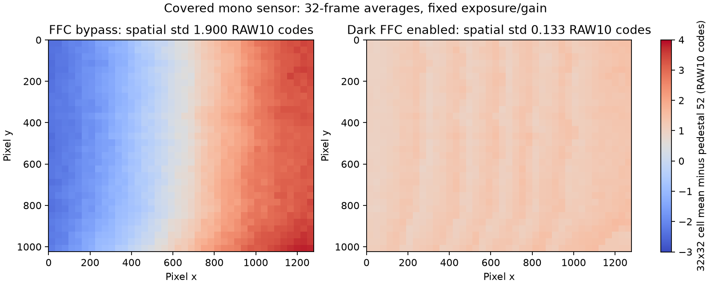

# Mono RAW10 FFC 实施与上板验证（2026-11-07）

暗场 FFC 已完成 RTL、软件、实现和 RAM 上板验证。当前板卡运行新硬件，FFC 已启用，Ibex AE 已恢复且 fault=0。**QSPI 未改动**，BOOT_MODE 已恢复为物理 QSPI 模式 0x2；重启后回到此前稳定的 NV12 固化版，不会自动保留本次 RAM 中的 FFC。

本次是遮黑条件下的平滑暗场偏置校正，gainQ12 全部为 4096。尚未采集均匀亮场，因此没有标定空间灵敏度、镜头渐晕或完整 PRNU；也不包含逐像素坏点修复。

## 实现与变更文件

FFC 位于 BLC/LTM、AE 统计和 TNR 之前，每时钟处理两个 RAW10 像素，固定六级寄存器延迟。1280×1024 图像采用 32 像素间距、41×33 节点的双线性插值网格。上传非活动 bank，逐字读回验证，在有效 SOF 切换；复位默认旁路。

计算为 `clip10(round(max(raw-dark,0)*gainQ12/4096)+pedestal)`。pedestal 保持 52，与已有 BLC=52 配套。四份系数 RAM 加统计 RAM 共使用 14 个 BRAM36。未增加时钟域或 A53 逐像素处理。

- RTL：`platform/zu4ev/isp/ffc/{ffc_raw10,ffc_stats,ffc_dual_ram}.sv`。
- ISP 集成：`platform/zu4ev/isp/isp_capture_frontend.sv`、`platform/zu4ev/isp/ltm/isp_axi_regs.sv`。
- 控制和标定：`platform/zu4ev/software/isp-control/ffcctl.c`、同目录 Makefile、`platform/zu4ev/isp/ffc/calibrate.py`。
- sensor 元数据：`integration/small/tools/ps_iic_probe.c` 新增只读 `calibration-probe`。
- 构建：`platform/zu4ev/tools/build_ffc_project.tcl`、`platform/zu4ev/boot/package_ffc_ram.py`。
- 测试：`tests/zu4ev/ffc/`；寄存器和使用说明：`platform/zu4ev/isp/ffc/{DESIGN,README}.md`。

`ffcctl` 与已有程序共享 ownership/ISP 锁，执行前必须完整停止并回收 Ibex。PL 直接累计 32 帧的 1280 个网格和，不使用旧 RAW VDMA。A53 只在显式标定时读取统计、一次性加载表。

## 验证结果

- 1280×1024、32 帧统计、随机空拍：整数 golden 检查 24,248,321 对输出像素，seed=ffc12345。
- 双通道插值、饱和/下溢、旁路、bank 切换、非法/不完整上传、异常帧拒绝均通过；小尺寸额外验证失败批次重新采集恢复。
- AXI 独立 AW/W、并发读写、B/R 背压、系数读回、非法访问、原始和已启用校正输出统计均通过。
- 五项 Python 标定测试通过，包括 CLI 文件 SHA256 一致性。
- 原有 NV12 十个仿真 bench 均通过。
- ARM 静态工具以 -Wall -Wextra -Werror 编译通过；sensor 探测的状态及 preflight 原生测试通过。
- 完整综合、布局布线、bitstream 生成通过。setup WNS=+0.033 ns、TNS=0；hold WHS=+0.010 ns、THS=0。verify_h264_timing.tcl 的时序、DRC 和 bus skew 验收全部通过。

全工程放置资源：LUT 59,186（67.38%）、FF 59,133（33.66%）、BRAM 114.5（89.45%）、URAM 36（75%）、DSP 92（12.64%）。初版 RAM 曾映射为 LUTRAM，已改为同步双端口 RAM，并重新完成实现验收。

## 暗场实测

AE 暂停、PS 独占 ISP/sensor 时采集。每个数值为 **32×32 像素、32 帧**的均值，不能解读为逐像素时间噪声。

| 批次 | 网格均值的平均值 | 网格均值的空间标准差 | 最大/最小网格均值之差 |
|---|---:|---:|---:|
| 初始原始 RAW | 52.6074 | 1.89835 | 6.24670 |
| 启用暗场 FFC | 53.1881 | 0.13463 | 0.68686 |
| 再次旁路 | 52.6041 | 1.90016 | 6.25641 |
| 重新启用 FFC | 53.1851 | 0.13329 | 0.67566 |

空间标准差改善约 **93.0%**，并通过关闭、重新上传、重新启用的重复测量。输出暗场均值约 53.19，没有强制压至 52；非负截断会保留正向暗噪声，不能宣称暗噪声被消除。

采集前与成功复读的寄存器一致：320e/320f=02/11，3e00/01/02/03=00/20/d0/0a，3e08/09=02/20。中间一次只读探测失败，随后重试成功，完整 UART 记录保留失败证据。未测得 sensor 温度；这份表只对记录条件有验证依据，不能外推至所有曝光、增益、温度。

## 视频回归与当前状态

- `nv12_vcu_probe 2400 /tmp/ffc-vcu.h264`：PASS，2400 帧、9,774,844 编码字节、20,174.829 ms，约 118.96 fps。
- USB 第一轮：35.305 秒、4003 解码帧；第二轮重新开流：35.319 秒、4022 解码帧。格式 H.264、1280×1024、yuv420p。
- 第一轮关闭流附近记录一次 USB_ERR_BUFFER（ns=436266085110，bytesused=0），随后主机 STREAMOFF；不能宣称整个会话 USB 零错误。第二轮重新开流与停流没有新增错误。最终 sent=returned=8331、invalid=0，ownership/dq/event/send 错误均为 0。
- 恢复 AE 后 owner/run/grant/armed=1、quiescent/fault=0，DP/capture 持续推进。此前 NV12 偶发 AE 启动握手问题本次没有复现，也没有在本任务中修复。

## 产物与复现

标定表、原始/校正统计、元数据、对比图和哈希保存在 [mono-ffc-20261107](mono-ffc-20261107/manifest.json)。

- bitstream：build/ffc/camera_top.bit，7,797,858 字节，SHA256 171c8aef3c37ef3c1e99610546f63c2de77b4806510ccd3352a86b688116777a。
- 系数表：docs/verification/mono-ffc-20261107/dark.map，SHA256 9e6b2e4b81313aad2ecae886a03c6f16c8d78454051acf5f881322f2b0f8bdcb。
- 项目：build/ffc/project/ffc.xpr；实现报告：build/ffc/route_reports/。
- RAM 镜像：build/ffc/ram_candidate_hold/{BOOT.BIN,image.ub}，使用 RAM-test FSBL，**不是生产 QSPI 包**。启动协调器等待 /tmp/ffc-allow-ae，PS 标定结束后创建该标志恢复 AE；当前板卡已完成此步骤。
- 完整串口、VCU/USB 样本和日志：build/ffc/board/；源文件与产物哈希：build/ffc/manifest.json。

未生成或烧录新的生产 QSPI 包。下一阶段均匀亮场标定、正常照明下的图像质量验证，需要移除遮挡并提供均匀、未饱和的光场。
